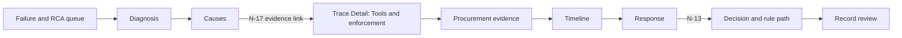
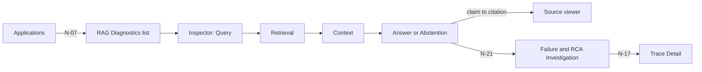
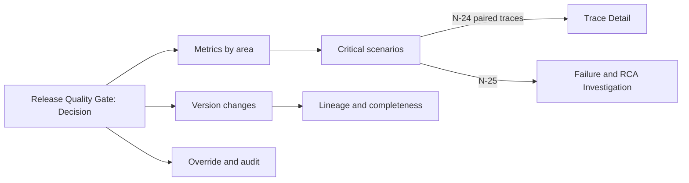

# User task flows

Revision 0.2 · 2026-10-17 · DRAFT. Part of the [dashboard UX architecture](README.md).

Four flows translate the project's Figures 2 to 5 into what a person does in the dashboard: valid procurement, approval bypass, RAG failure and release regression. Each flow names who does it, lists the steps, the fields that must be visible at each step (IDs from the [field matrix](field-owner-matrix.md)), the question answered, and the distinctions the screen must keep. Screens and links are those in the [information architecture](information-architecture.md). Roles are those of [roles and access](roles-and-access.md).

## Figures behind the flows

| Flow | Figure | What the figure shows | Proposal and stories it follows |
|---|---|---|---|
| F1 Valid procurement | Figure 2 | Procurement agent trace processing: online pre-execution control, then post-run evaluation, classification, RCA and decision | §N.1, §Y.1 valid approval path, US-02, US-21 to US-24 |
| F2 Approval bypass | Figures 2 and 3 | Figure 3 is the execution graph of the approval-bypass attempt: policy requirement, blocked action and unsupported completion | §N.1 approval-bypass demonstration, US-04, US-12, US-22, US-37, US-39 |
| F3 RAG failure | Figure 4 | Evaluator families feed the rule baseline and XGBoost, then failure classification, RCA and the decision | §K, §L, §N.2, US-15, US-19, US-20, US-38 |
| F4 Release regression | Figure 5 | Baseline and candidate on the same versioned dataset, evaluation, regression comparison and the PASS, REVIEW or BLOCK gate | §S, US-32, US-33, US-40 |

Figure 1 (the architecture) shows the dashboard fed by the backend, which is why no screen computes anything.

## Who does what

| Flow | Main role | Also | Landing screen for the main role |
|---|---|---|---|
| F1 Valid procurement | AI Engineer | Governance Reviewer confirms a PASS | Applications |
| F2 Approval bypass | Governance Reviewer | Reliability Engineer reads the diagnosis | Failure & RCA Investigation |
| F3 RAG failure | AI Engineer | Reliability Engineer | Applications |
| F4 Release regression | LLMOps Engineer | Governance Reviewer approves or rejects an override | Release Quality Gate |

## F1 — Valid procurement

**Goal.** Confirm that a trace marked PASS is a genuine, fully evidenced success: a compliant mock purchase order that the final response truthfully reports.

**Entry.** Applications landing, then an application card; or the Overview decision tile.

| # | Screen | The person does | Must see | Question answered |
|---|---|---|---|---|
| 1 | Applications | Reads the Procurement card's versions, latest evaluation run and gate decision, then opens View traces (N-06) | `APP-05` `APP-08` `APP-02` | Which configuration produced these traces, and was it evaluated? |
| 2 | Trace Explorer | Filters by application, decision Pass and failure label Normal, opens a row (N-10) | `TRX-01` `TRX-03` `TRX-04` `TRD-01` `RCA-07` `RCA-01` | Is the evidence complete, and is this a live run or a replay? |
| 3 | Trace Detail, Summary | Reads outcome, run status, decision and label side by side | `TRD-01` `TRD-02` `RCA-07` `RCA-01` | Do outcome, run, decision and label agree? |
| 4 | Timeline | Follows the states and the graph | `TRD-20` `TRD-21` `TRD-22` `TRD-23` | Did every state follow its predecessor, ending in COMPLETION? |
| 5 | Request and model | Compares raw and normalized request | `TRD-10` `TRD-11` `TRD-13` `TRD-14` | Was the request understood once, and is telemetry known or Unavailable (not 0)? |
| 6 | Procurement evidence | Checks policy, supplier and approval | `TRD-30` `TRD-31` `TRD-32` `TRD-33` `TRD-34` `TRD-35` | Was the supplier approved, was approval required, and was a valid approval bound to this request? |
| 7 | Tools and enforcement | Checks proposal, guard, verdict, dispatch and result | `TRD-40` `TRD-41` `TRD-42` `TRD-43` `TRD-44` `TRD-45` `TRD-47` | Was the PO proposal allowed before it ran, did it run once, and is the result confirmed? |
| 8 | Response | Compares raw and delivered text | `TRD-50` | Does the final claim match the confirmed result? |
| 9 | Evaluator outputs | Scans every evaluator and policy verdict | `TRD-60` `TRD-62` `TRD-63` | Does every evaluator have a value, with any Not applicable explained, and did all three policies pass? |
| 10 | Failure & RCA Investigation | Opens the investigation (N-13) and reads the rule path | `RCA-07` `RCA-08` `RCA-05` | Which rules and signals produced the PASS, and is any cause listed? |
| 11 | Trace Detail, Review and audit | Optionally records a review (Governance Reviewer) | `TRD-70` `TRD-71` | The human verdict sits beside, not over, the machine decision. |

```mermaid
flowchart LR
 APP[Applications] -->|N-06| TRX[Trace Explorer]
 TRX -->|N-10 row| SUM[Trace Detail: Summary]
 SUM --> TL[Timeline] --> RQ[Request and model] --> PE[Procurement evidence]
 PE --> TE[Tools and enforcement] --> RS[Response] --> EO[Evaluator outputs]
 EO -->|N-13| RCA[Failure and RCA Investigation]
 RCA --> REV[Review and audit]
```

**The PASS is supported when** the trace is complete, every evaluator has a value or an explained Not applicable, all three policies passed, the pre-tool verdict was Allow and bound to the proposal, the tool ran once with a confirmed result, and the delivered text matches that result.

**Branches the screens must handle**

| Branch | What the person sees | What the screen must not do |
|---|---|---|
| Approval not required | `TRD-35` shows basis NOT_REQUIRED with calculation evidence; approval ID and received flag are ⊘ Not applicable | Show an invented approval or a Missing evidence marker |
| Run waiting for approval | Run WAITING_APPROVAL, `RCA-07` is ◔ Awaiting result | Render the run as Pass |
| Unknown PO outcome | Outcome Recovery pending, `TRD-46` shows the lookup state | Call the purchase failed or succeeded |
| An evaluator is ○ Not evaluated or ▲ Evaluator failed | The state is visible in `TRD-60` and counted in `OVW-05` | Hide it behind an overall Pass (Q-06 asks Mohamed what the engine does) |
| Amount equals the approval threshold | `TRD-32` shows amount, threshold and comparator | Hide the comparator |
| Incomplete trace | ✕ Missing evidence in the affected sections and in `TRD-82` | Show a blank panel |

## F2 — Approval bypass with a false completion claim

**Goal.** Establish, from evidence, that a premature purchase-order proposal was stopped before dispatch, that nothing ran, and that a contradicting completion claim was generated, and see how it was classified and decided.

**Entry.** The Governance Reviewer lands on the Failure & RCA queue. The Overview decision tile (N-01) and a failure class (N-02) lead to the same traces through Trace Explorer.

| # | Screen | The person does | Must see | Question answered |
|---|---|---|---|---|
| 1 | Failure & RCA Investigation | Filters the queue to Block and opens a trace | `RCA-01` `RCA-07` | Which trace, and why is it queued? |
| 2 | Diagnosis tab | Reads label, score, other findings and rules | `RCA-01` `RCA-02` `RCA-03` `RCA-04` `RCA-10` | Workflow violation, with an unsupported completion found beside it? Which rules fired? |
| 3 | Causes tab | Reads the Top-3 and their evidence scores | `RCA-05` `RCA-06` | What do the ranked causes point to, and which events support them? |
| 4 | Trace Detail, Tools and enforcement | Follows an evidence link (N-17) | `TRD-40` `TRD-41` `TRD-42` `TRD-43` `TRD-44` `TRD-45` `TRD-47` | Was a PO proposed, which rules blocked it, which layer stopped it, and did anything run? |
| 5 | Procurement evidence | Checks approval | `TRD-32` `TRD-34` `TRD-35` | Was approval required, and was none received? |
| 6 | Timeline | Checks the sequence and the graph | `TRD-22` `TRD-23` `TRD-20` `TRD-21` | Which state was active, and was a transition to APPROVED ever accepted? |
| 7 | Response | Compares raw and delivered text | `TRD-50` | Was a false success claim generated, and was it shown? |
| 8 | Failure & RCA Investigation, Decision tab | Returns and reads the decision | `RCA-07` `RCA-08` | What is the decision, and which rules and signals produced it? |
| 9 | Review | Records a verdict | `TRD-70` `TRD-71` | Is the machine Block confirmed? The entry is immediate and cannot be edited. |

**Four things stay separate on screen**

1. The proposal (`TRD-40`): it exists whether or not it ran.
2. The pre-tool verdict (`TRD-43`): `⊣ Pre-tool Block`, with the failed rules, and the layer that stopped the call (`TRD-44`).
3. Dispatch (`TRD-44`): `∅ Not executed`, with a result row that says Not applicable because nothing ran.
4. The completion claim (`TRD-50`): raw and delivered text, independent of the other three.

**Invariants**

- A prevented attempt is still a finding. The reliability decision stays Block even though no tool ran.
- `⊣ Pre-tool Block`, `■ Reliability Block` and a reviewer's `Human review: Block` are different things with different signatures and scope labels.
- The screen never shows a successful tool result for a blocked call.
- The false claim and the missing approval are independent findings. Either can appear without the other.
- Causes appear in the engine's order with evidence scores, never as probabilities.

**Branches**

| Branch | What the person sees |
|---|---|
| The agent guard stopped it first (US-03) | `TRD-47` holds the rejection and the stage; the policy rows read ⊘ Not applicable |
| No suppression record and no result | ✕ Missing evidence on dispatch and result: whether the step ran is unknown, so it is not shown as Not executed |
| Verdict timed out or is missing | A technical-error state on `TRD-43`: no dispatch, and neither a policy fail nor an Allow |
| Raw text claims success but the delivered text is the honest block message | Both shown, with a flag for which was delivered |
| Model claims "approval granted" | Approval evidence (`TRD-34`) is unchanged: received is false |
| The reviewer is an Administrator | The entry in `TRD-70` and `TRD-71` carries the administrator-action flag |

## F3 — RAG failure

**Goal.** Locate where a RAG query went wrong, in retrieval, selection or generation, using the returned documents, the selected context, the expected evidence and the claim-to-source chain, and name its failure type.

**Entry.** The AI Engineer lands on Applications and opens the RAG assistant's queries. Failure & RCA (N-19) is an alternative entry.

| # | Screen | The person does | Must see | Question answered |
|---|---|---|---|---|
| 1 | Applications | Opens Inspect queries on the RAG card (N-07) | `APP-01` `APP-05` | Which retriever and corpus version are deployed? |
| 2 | RAG Diagnostics | Filters the list to Needs attention and picks a query | `RAG-19` `RAG-10` | Which query? |
| 3 | Inspector, Query | Reads the query and settings | `RAG-01` `RAG-02` `RAG-03` `RAG-20` | Was the query transformed, and with what retriever, corpus and index? |
| 4 | Inspector, Retrieval | Reads outcome, documents, scores, expected evidence, metrics | `RAG-04` `RAG-05` `RAG-06` `RAG-09` `RAG-10` | Did retrieval succeed, what came back in what order, and was the expected source missing? |
| 5 | Inspector, Context | Compares returned and selected | `RAG-07` `RAG-08` | What did the model actually see, and was it judged sufficient? |
| 6 | Inspector, Answer or Abstention | Reads outcome, text and scores | `RAG-11` `RAG-16` `RAG-17` `RAG-19` `RAG-21` | Did the assistant abstain or answer, was that appropriate, and how grounded was the answer? |
| 7 | Source viewer | Opens a cited source | `RAG-13` `RAG-14` `RAG-15` `RAG-18` | Does the cited text support the claim? |
| 8 | Failure & RCA Investigation | Opens the investigation (N-21) | `RCA-01` `RCA-05` `RCA-06` | What failure type and causes were assigned, with what evidence? |
| 9 | Trace Detail | Opens the full trace (N-20) | `TRD-80` `TRD-13` | What versions ran, and was a model call made? |

**Variant F3b: unsupported answer with good retrieval (SC-01).** At step 7 the citation resolves structurally (✓ in `RAG-14`) but `RAG-15` reports the claim is not supported by the cited text. The candidate answer is kept in `RAG-11`. The execution mode in `TRX-04` reads "synthetic output replay", and `TRD-13` reads Not applicable, so the defect is not attributed to the model.

**Invariants**

- Retrieved order and selected order are two lists.
- A retrieval error and an empty successful retrieval look different.
- A safe abstention can still sit beside a labeled retrieval failure.
- A structurally valid citation and a supported claim are different lines.
- Expected evidence is evaluation-side and is labeled that way. Missing expected-evidence metadata is Not evaluated, not zero.
- A metric shows its name, unit and direction.

**Branches**

| Branch | What the person sees |
|---|---|
| Retrieval service error | `RAG-04` shows Error with the stage, `RAG-05` is empty with a reason, and metrics are ▲ or ○, never `0` |
| Poisoned retrieved chunk | `RAG-20` shows the attack text, its location and source version, and `TRD-63` shows the security verdict |
| Evaluator did not run | `RAG-15` and `RAG-21` show ○ Not evaluated |

## F4 — Release regression

**Goal.** Decide whether a blocked or flagged release candidate really regressed against the approved baseline, what changed, and whether a BLOCK may be overridden.

**Entry.** The LLMOps Engineer lands on Release Quality Gate. The Overview release gate tile (N-04) and an application's gate link (N-08) lead to the same record.

| # | Screen | The person does | Must see | Question answered |
|---|---|---|---|---|
| 1 | Release Quality Gate, Decision | Reads decision, disposition and reasons | `REL-01` `REL-02` `REL-03` `REL-17` `REL-18` | Which candidate and baseline, what decision, what happens to the candidate, and what is the source artifact? |
| 2 | Metrics by area | Reads the comparison for RAG, Agent, Security and Overall | `REL-04` `REL-05` `REL-06` | Which metrics moved, by how much, with what sample, against what tolerance? |
| 3 | Critical scenarios | Reads scenarios, class shifts and critical failures | `REL-09` `REL-10` `REL-11` | Which scenarios regressed, did a new class appear, and did a critical policy or security failure appear? |
| 4 | Version changes | Reads what changed | `REL-07` `REL-08` | Is the comparison like for like? |
| 5 | Lineage and completeness | Checks completeness and reproducibility | `REL-12` `REL-13` `REL-14` | Was the run complete, and can it be reproduced? |
| 6 | Trace Detail | Opens the baseline and candidate trace of one scenario (N-24) | `TRD-80` `TRD-43` `TRD-62` | What differed in the evidence and the versions? |
| 7 | Failure & RCA Investigation | Opens a new class (N-25) | `RCA-01` `RCA-05` | What failure type and causes explain it? |
| 8 | Release Quality Gate, Override and audit | The LLMOps Engineer requests an override with a written reason | `REL-19` `REL-20` | Is an override justified? The request is logged. |
| 9 | Release Quality Gate, Decision | A Governance Reviewer approves or rejects, or records a release review | `REL-19` `REL-16` `REL-20` | The approval names the candidate and is audit-logged and flagged if an Administrator acts. |

**Invariants**

- The release gate decision carries the label "Release gate" and is not the same field as a trace's reliability decision.
- Figures are those of the gate artifact. The screen recalculates nothing.
- A missing tolerance is ▢ Not configured, never a pass.
- An incomplete run is ✕ Missing evidence and is never presented as a clean comparison.
- Fixture-deterministic and live-model runs are labeled, with a note that live output is not deterministic (`REL-14`).
- Paired cases (baseline and candidate of one scenario) are always offered together.
- BLOCK states the approved baseline is retained. REVIEW states human action is required and is not an approval.

**Branches**

| Branch | What the person sees |
|---|---|
| Thresholds not yet set (OD-15) | `REL-06` is ▢ Not configured; the decision shows exactly what the owner serves |
| A gate metric's evaluator failed | The metric row is ▲ Evaluator failed and is listed among the reasons if the owner counts it |
| Baseline and candidate used different evaluation sets | `REL-08` shows both, with a comparison caveat |
| The role may not request or approve an override | The control is unavailable with the reason in text; the backend rejects the action regardless |

## Flow-to-screen coverage

Every screen is used by at least one flow. This table is a quick check that no screen is orphaned.

| Screen | F1 | F2 | F3 | F4 |
|---|---|---|---|---|
| Reliability Overview | ○ | ○ | | ○ |
| Applications | ● | | ● | |
| Trace Explorer | ● | ○ | | ○ |
| Trace Detail | ● | ● | ● | ● |
| RAG Diagnostics | | | ● | |
| Failure & RCA Investigation | ● | ● | ● | ● |
| Release Quality Gate | | | | ● |

● used on the main path · ○ alternative entry.
