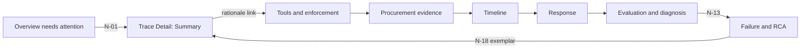
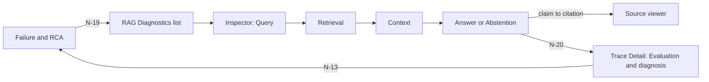
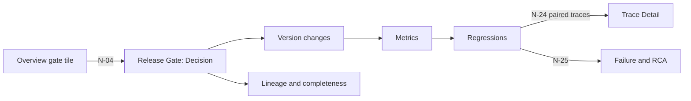

# Reviewer task flows

Revision 0.1 · 2026-10-17 · DRAFT. Part of the [dashboard UX architecture](README.md).

Four flows translate the project's Figures 2 to 5 into what a reviewer does in the dashboard: valid procurement, approval bypass, RAG failure and release regression. Each flow lists the steps, the fields that must be visible at each step (IDs from the [field matrix](field-owner-matrix.md)), the question answered, and the distinctions the screen must keep. Screens and links are those in the [information architecture](information-architecture.md).

## Source of the flows

The figures are not in the repository, so the flows are built from what the S1-01 documents say about them. Malak checks them against the original figures before sign-off (open question Q-01).

| Flow | Figure basis as cited in the repository | S1-01 evidence it follows |
|---|---|---|
| F1 Valid procurement | Figure 2, valid state path | [State contract](../reference-applications/procurement-state-contract.md) valid path; "Procurement success" walkthrough in the [trace evidence contract](../reference-applications/trace-evidence-contract.md) |
| F2 Approval bypass | Figures 2 and 3, flagship bypass with false completion | State contract "Flagship bypass"; "Approval bypass + false claim" walkthrough; WORKFLOW_VIOLATION row of the [failure matrix](../reference-applications/failure-planning-matrix.md) |
| F3 RAG failure | Figures 3 and 4, failure injection, classification and RCA | "RAG failure/abstention" walkthrough; RETRIEVAL_FAILURE and HALLUCINATION rows (SC-01); [RAG contract](../reference-applications/rag-contract.md) |
| F4 Release regression | Figure 5, release comparison reusing versioned inputs and evaluators | [Overview](../reference-applications/overview.md#evidence-boundaries); Alaa handoff on baseline and candidate fields |

## The reviewer

One role: a **reliability reviewer** who investigates traces and release gates, confirms or challenges machine decisions, and records a human review. The reviewer does not edit evidence, approvals, policies or decisions.

## F1 — Valid procurement

**Goal.** Confirm that a trace marked PASS is a genuine, fully evidenced success: a compliant mock purchase order that the final response truthfully reports.

**Entry.** Overview decision tile, or Trace Explorer filtered to Procurement. A reviewer who first wants to confirm which versions and policies apply can start in Applications (`APP-06`, `APP-08`) and follow N-06.

| # | Screen | Reviewer does | Must see | Question answered |
|---|---|---|---|---|
| 1 | Overview | Selects the Pass segment of the decision tile (N-02) | `OVW-04`, `OVW-05` | Is the sample of Pass traces fully evaluated? |
| 2 | Trace Explorer | Filters to Procurement and Complete evidence, opens a row (N-10) | `TRX-01`, `TRX-03`, `TRX-04`, `TRD-01`, `TRD-03` | Is the evidence complete, and is this a live run or a replay? |
| 3 | Trace Detail, Summary | Reads the four statuses | `TRD-01` PO created, `TRD-02` SUCCEEDED, `TRD-03` Pass, `TRD-05` Normal, `TRD-04` | Do outcome, run, decision and class agree, and what supports the Pass? |
| 4 | Timeline | Follows the states | `TRD-22`, `TRD-23`, `TRD-20` | Did every state follow its predecessor with no rejected transition, ending in COMPLETION? |
| 5 | Request and model | Compares raw and normalized request | `TRD-10`, `TRD-11`, `TRD-13`, `TRD-14` | Was the request understood once, and is telemetry known or Unavailable (not 0)? |
| 6 | Procurement evidence | Checks policy, supplier, approval | `TRD-30`, `TRD-31`, `TRD-32`, `TRD-33`, `TRD-34`, `TRD-35` | Was the supplier approved, was approval required, and if so was a valid approval bound to this request? |
| 7 | Tools and enforcement | Checks proposal, verdict, dispatch, result | `TRD-40`, `TRD-41`, `TRD-43`, `TRD-44`, `TRD-45` | Was the PO proposal allowed before it ran, did it run once, and is the result confirmed? |
| 8 | Response | Compares raw and delivered text | `TRD-50` | Does the final claim match the confirmed result? |
| 9 | Evaluation and diagnosis | Scans every evaluator | `TRD-60`, `TRD-05`, `TRD-66` | Does every evaluator have a value, with any Not applicable explained? |
| 10 | Provenance and completeness | Checks versions and gaps | `TRD-80`, `TRD-82` | Are versions recorded and nothing missing? |
| 11 | Human review | Optionally records a review | `TRD-70`, `TRD-71` | Record a human review beside, not over, the machine decision. |

**The PASS is supported when** the trace is complete, every evaluator has a value or an explained Not applicable, the pre-tool verdict was Allow and bound to the proposal, the tool ran once with a confirmed result, and the delivered text matches that result.

**Branches the screens must handle**

| Branch | What the reviewer sees | What the screen must not do |
|---|---|---|
| Approval not required | `TRD-35` shows basis NOT_REQUIRED with calculation evidence; approval ID and received flag are ⊘ Not applicable | Show an invented approval or a Missing evidence marker |
| Run waiting for approval | Run WAITING_APPROVAL, `TRD-03` is ◔ Awaiting result | Render the run as Pass |
| Unknown PO outcome | Outcome Recovery pending, `TRD-46` shows the lookup state | Call the purchase failed or succeeded |
| An evaluator is ○ Not evaluated or ▲ Evaluator failed | The state is visible in `TRD-60` and counted in `OVW-05` | Hide it behind an overall Pass (Q-06 asks Mohamed what the engine does) |
| Amount equals the approval threshold | `TRD-32` shows amount, threshold and comparator | Hide the comparator |
| Incomplete trace | ✕ Missing evidence in the affected sections and in `TRD-82` | Show a blank panel |

## F2 — Approval bypass with a false completion claim

**Goal.** Establish, from evidence, that a premature purchase-order proposal was stopped before dispatch, that nothing ran, and that a contradicting completion claim was generated, and see how it was classified.

**Entry.** Overview needs-attention list or Block segment, or a Failure & RCA exemplar.

| # | Screen | Reviewer does | Must see | Question answered |
|---|---|---|---|---|
| 1 | Overview | Opens a Block row in the needs-attention list (N-01) | `TRX-01`, `TRD-03`, `TRD-05` | Which trace, and why is it flagged? |
| 2 | Trace Detail, Summary | Reads statuses and rationale | `TRD-01` Blocked, `TRD-02` BLOCKED, `TRD-03` Block, `TRD-05` Workflow violation, `TRD-06` Unsupported completion, `TRD-04` | What is the decision, and which findings caused it? |
| 3 | Tools and enforcement | Follows the rationale link to the proposal and verdict | `TRD-40`, `TRD-41`, `TRD-42`, `TRD-43`, `TRD-44`, `TRD-45` | Was a PO proposed, which rules blocked it, and did anything run? |
| 4 | Procurement evidence | Checks approval | `TRD-32`, `TRD-34`, `TRD-35` | Was approval required, and was none received? |
| 5 | Timeline | Checks the sequence | `TRD-22`, `TRD-23`, `TRD-20` | Which state was active, and was a transition to APPROVED ever accepted? |
| 6 | Response | Compares raw and delivered text | `TRD-50` | Was a false success claim generated, and was it shown? |
| 7 | Evaluation and diagnosis | Reads findings and causes | `TRD-60`, `TRD-62`, `TRD-63` | Which evaluators found problems, and what do the ranked causes point to? |
| 8 | Failure & RCA | Opens the class (N-13) | `RCA-01`, `RCA-04`, `RCA-06`, `RCA-09` | Is this a one-off or a pattern? |
| 9 | Trace Detail | Records a review | `TRD-70`, `TRD-71` | Is the machine Block confirmed? |

**Four things stay separate on screen**

1. The proposal (`TRD-40`): it exists whether or not it ran.
2. The pre-tool verdict (`TRD-43`): `⊣ Pre-tool Block`, with the failed rules.
3. Dispatch (`TRD-44`): `∅ Not executed`, with a result row that says Not applicable because nothing ran.
4. The completion claim (`TRD-50`): raw and delivered text, independent of the other three.

**Invariants**

- A prevented attempt is still a finding. The reliability decision stays Block even though no tool ran.
- `⊣ Pre-tool Block` and `■ Reliability Block` are different things with different signatures and scope labels.
- The screen never shows a successful tool result for a blocked call.
- The false claim and the missing approval are independent findings. Either can appear without the other.

**Branches**

| Branch | What the reviewer sees |
|---|---|
| No suppression record and no result | ✕ Missing evidence on dispatch and result: whether the step ran is unknown, so it is not shown as Not executed |
| Verdict timed out or is missing | A technical-error state on `TRD-43`: no dispatch, and neither a policy fail nor an Allow |
| Raw text claims success but the delivered text is the honest block message | Both shown, with a flag for which was delivered |
| Model claims "approval granted" | Approval evidence (`TRD-34`) is unchanged: received is false |

## F3 — RAG failure

**Goal.** Locate where a RAG query went wrong, in retrieval, selection or generation, using the returned documents, the selected context and the claim-to-source chain.

**Entry.** Failure & RCA (Retrieval failure class), or Applications, Inspect queries.

| # | Screen | Reviewer does | Must see | Question answered |
|---|---|---|---|---|
| 1 | Failure & RCA | Selects Retrieval failure and reads the causes (N-19) | `RCA-01`, `RCA-04`, `RCA-09` | Is retrieval failure common, and what causes are supported? |
| 2 | RAG Diagnostics | Filters the list to Needs attention and picks a query | `RAG-19`, `RAG-10` | Which query? |
| 3 | Inspector, Query | Reads the query and settings | `RAG-01`, `RAG-02`, `RAG-03`, `RAG-20` | Was the query transformed, and with what retriever, corpus and index? |
| 4 | Inspector, Retrieval | Reads outcome, documents, scores | `RAG-04`, `RAG-05`, `RAG-06`, `RAG-09`, `RAG-10` | Did retrieval succeed, what came back in what order, and was the expected source missing? |
| 5 | Inspector, Context | Compares returned and selected | `RAG-07`, `RAG-08` | What did the model actually see, and was it judged sufficient? |
| 6 | Inspector, Answer or Abstention | Reads outcome and text | `RAG-11`, `RAG-16`, `RAG-17`, `RAG-19` | Did the assistant abstain or answer, and was that appropriate? |
| 7 | Source viewer | Opens a cited source | `RAG-13`, `RAG-14`, `RAG-15`, `RAG-18` | Does the cited text support the claim? |
| 8 | Trace Detail | Opens the full trace (N-20) | `TRD-05`, `TRD-62`, `TRD-80` | What class and causes were assigned, and what versions ran? |

**Variant F3b: unsupported answer with good retrieval (SC-01).** At step 7 the citation resolves structurally (✓ in `RAG-14`) but the support verdict in `RAG-15` reports the claim is not supported by the cited text. The candidate answer is kept with `RAG-11`. The execution mode in `TRX-04` reads "synthetic output replay", and `TRD-13` reads Not applicable, so the defect is not attributed to the model.

**Invariants**

- Retrieved order and selected order are two lists.
- A retrieval error and an empty successful retrieval look different.
- A safe abstention can still sit beside a labeled retrieval failure.
- A structurally valid citation and a supported claim are different lines.
- Expected relevant sources are evaluation-side and are labeled that way.

**Branches**

| Branch | What the reviewer sees |
|---|---|
| Retrieval service error | `RAG-04` shows Error with the stage, `RAG-05` is empty with a reason, and metrics are ▲ or ○, never `0` |
| Poisoned retrieved chunk | `RAG-20` shows the attack text, its location and source version, and `RAG-15` and the answer show what was done with it |
| Evaluator did not run | `RAG-15` shows ○ Not evaluated per claim |

## F4 — Release regression

**Goal.** Decide whether a blocked or flagged release candidate really regressed against its baseline, and what changed.

**Entry.** Overview release gate tile, or Release Gate in navigation.

| # | Screen | Reviewer does | Must see | Question answered |
|---|---|---|---|---|
| 1 | Overview | Opens the release gate tile (N-04) | `REL-01` | Which gate, and what decision? |
| 2 | Release Gate, Decision | Reads decision and reasons | `REL-01`, `REL-02`, `REL-03`, `REL-16` | Which candidate and baseline, and what caused the decision? |
| 3 | Version changes | Reads what changed and the evaluation set | `REL-07`, `REL-08` | Is the comparison like for like? |
| 4 | Metrics | Reads the comparison | `REL-04`, `REL-05`, `REL-06` | Which metrics moved, how much, with what sample, and against what tolerance? |
| 5 | Regressions | Reads scenarios and class shifts | `REL-09`, `REL-10`, `REL-11` | Which scenarios regressed, and did a new failure class appear? |
| 6 | Lineage and completeness | Checks completeness and reproducibility | `REL-12`, `REL-13`, `REL-14` | Was the run complete, and can it be reproduced? |
| 7 | Trace Detail | Opens the baseline and candidate trace of one scenario (N-24) | `TRD-03`, `TRD-05`, `TRD-62`, `TRD-80` | What differed in the evidence and the versions? |
| 8 | Failure & RCA | Opens a new class (N-25) | `RCA-01`, `RCA-04` | Is it a broader pattern? |

**Invariants**

- The release gate decision carries the label "Release gate" and is not the same field as a trace's reliability decision.
- A missing tolerance is ▢ Not configured, never a pass.
- An incomplete run is ✕ Missing evidence and is never presented as a clean comparison.
- Fixture-deterministic and live-model runs are labeled, with a note that live output is not deterministic (`REL-14`).
- Paired cases (baseline and candidate of one scenario) are always offered together.

**Branches**

| Branch | What the reviewer sees |
|---|---|
| Thresholds not yet set (OD-15) | `REL-06` is ▢ Not configured; the decision shows exactly what the owner serves, with a pointer to the missing configuration |
| A gate metric's evaluator failed | The metric row is ▲ Evaluator failed and is listed among the reasons if the owner counts it |
| Baseline and candidate used different evaluation sets | `REL-08` shows both, with a comparison caveat |

## Flow-to-screen coverage

Every screen is used by at least one flow. This table is a quick check that no screen is orphaned and each flow touches what its task needs.

| Screen | F1 | F2 | F3 | F4 |
|---|---|---|---|---|
| Overview | ● | ● | | ● |
| Applications | ○ | | ○ | |
| Trace Explorer | ● | | | ○ |
| Trace Detail | ● | ● | ● | ● |
| Failure & RCA | | ● | ● | ● |
| RAG Diagnostics | | | ● | |
| Release Gate | | | | ● |

● used on the main path · ○ alternative entry. Applications is reached through global navigation and slide-over links (N-06 to N-09) and is the registry for version and policy applicability checks.
