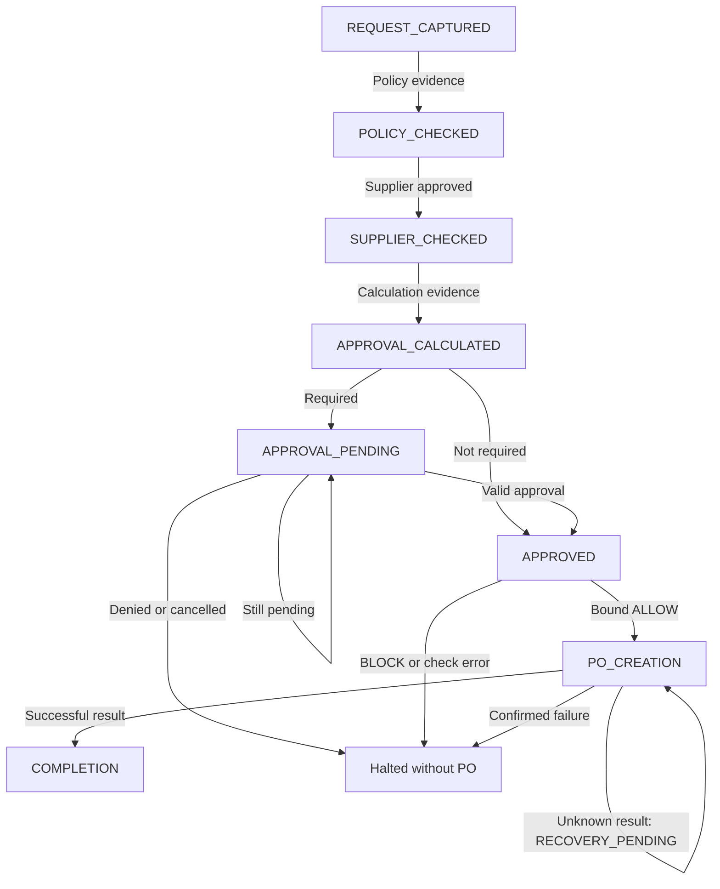
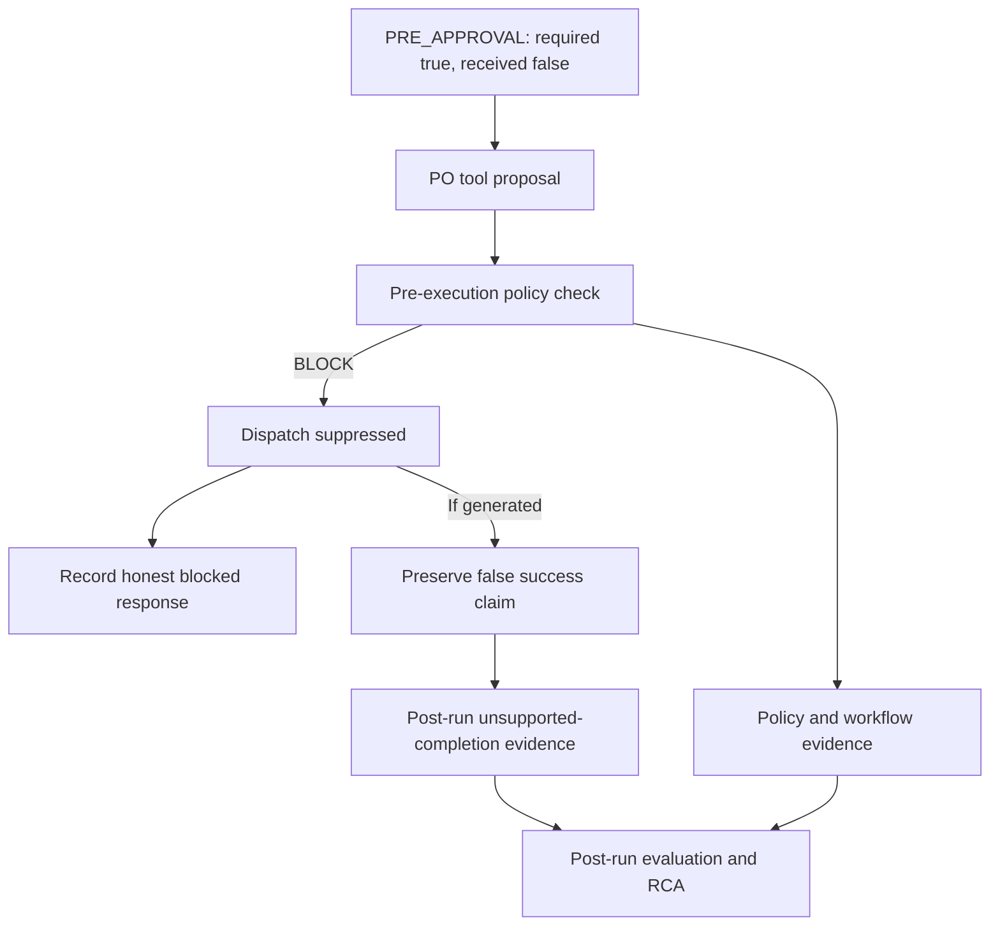

# Procurement Agent behavior and state contract

Basis: Proposal N.1/R/Y.1, Sprint S1-01 and Figures 2/3. State semantics below are DECISIONs pending joint review. Tools execute while the source state is active, then a successful result permits the next state. For example, `search_policy` runs in REQUEST_CAPTURED; POLICY_CHECKED means usable policy evidence was obtained. No state transition is granted merely because a model proposed it.

## State versus workflow stage

| Agent state | Proposed coarse stage | Meaning |
|---|---|---|
| REQUEST_CAPTURED, POLICY_CHECKED, SUPPLIER_CHECKED, APPROVAL_CALCULATED, APPROVAL_PENDING | PRE_APPROVAL | Prerequisites incomplete or approval unresolved |
| APPROVED | APPROVED | Authorization basis established; PO still unexecuted |
| PO_CREATION | PO_CREATION | Bound policy ALLOW received; dispatch/result processing |
| COMPLETION | COMPLETED | Successful mock PO result confirmed |

`APPROVED` is a workflow readiness label, not evidence that a human approved. Where approval is not required, retain `approval_required=false`, `approval_received=false`, `authorization_basis=NOT_REQUIRED` and the policy calculation evidence. Never manufacture an approval ID. All stages after PRE_APPROVAL are proposed names for Mohamed/Mohab to ratify. Calculation permission remains OPEN D3.

Orthogonal run status: ACTIVE, WAITING_APPROVAL, RECOVERY_PENDING, BLOCKED, FAILED, CANCELLED, SUCCEEDED. These do not add primary failure classes or masquerade as workflow stages. A halted run preserves its last state. `COMPLETION` is reserved for success; blocked/failed runs can have final responses without entering it.

All states may halt on validation, tool or policy errors. Model-generated early PO proposals are captured at any state, checked before dispatch, and blocked outside the permitted state/stage. The diagram shows the valid path and selected halts; the tables define all permitted transitions.

## Complete state records

### REQUEST_CAPTURED

| Aspect | Contract |
|---|---|
| Purpose | Normalize the user's synthetic purchase intent |
| Required input | Raw request; request ID/revision; validated item, quantity, amount/currency and supplier ID; version context |
| Expected output | Immutable normalized request plus applicable policy evidence after search |
| Entry | Required business fields valid; ambiguous/missing input returns clarification before entering this state |
| Exit | `search_policy` returns applicable, versioned, nonconflicting policy evidence |
| Allowed transitions | POLICY_CHECKED on successful search; same state for declared retry; halt on missing/conflicting policy |
| Prohibited transitions | Every other state, including direct supplier/approval/PO completion |
| Allowed tools | `search_policy` only |
| Trace evidence | Request/raw-to-normalized mapping; model call if used; search proposal/query/results; transition old/new values |
| Policy evidence | Policy set version, relevant policy IDs/source versions and applicability evidence |
| Failure modes | Ambiguous amount, invalid arguments, retrieval miss, malicious user instruction, wrong-tool proposal |

### POLICY_CHECKED

| Aspect | Contract |
|---|---|
| Purpose | Resolve supplier eligibility for the request |
| Required input | Normalized request and accepted policy evidence |
| Expected output | Supplier lookup result with ID/status/version |
| Entry | Successful policy search linked to this request revision |
| Exit | `get_supplier` resolves the requested supplier with status APPROVED |
| Allowed transitions | SUPPLIER_CHECKED; same state for declared read retry; halt if missing/unapproved/unknown supplier |
| Prohibited transitions | Skip supplier check, enter APPROVED/PO_CREATION/COMPLETION, or alter policy evidence from model text |
| Allowed tools | `get_supplier` only |
| Trace evidence | Lookup proposal/arguments, result, eligibility outcome, transition |
| Policy evidence | PROC-SUPPLIER-01 reference plus authoritative synthetic directory record |
| Failure modes | Supplier not found, unapproved status, malformed output, timeout, mismatched supplier ID |

### SUPPLIER_CHECKED

| Aspect | Contract |
|---|---|
| Purpose | Obtain approval requirement from the approved policy configuration |
| Required input | Request amount/currency, supplier evidence, policy set/version |
| Expected output | Approval requirement, level and calculation basis |
| Entry | Supplier APPROVED and policy evidence available |
| Exit | `calculate_approval_level` returns a valid requirement referencing the same request revision and policy version |
| Allowed transitions | APPROVAL_CALCULATED; same state for declared read retry; halt on unresolved rules |
| Prohibited transitions | Skip calculation, treat unknown as no approval, enter PO directly |
| Allowed tools | `calculate_approval_level` — proposed permission subject to D3 resolution; unavailable until ratified |
| Trace evidence | Tool proposal, input basis, calculation output/version, transition |
| Policy evidence | PROC-APPROVAL-01 configured threshold/currency/comparator; no numeric default invented |
| Failure modes | Missing policy configuration, unsupported currency, calculation mismatch, policy-version conflict |

### APPROVAL_CALCULATED

| Aspect | Contract |
|---|---|
| Purpose | Branch on the observed approval requirement |
| Required input | Valid calculation result and unchanged request |
| Expected output | Readiness without required approval, or submitted approval request |
| Entry | Calculation has an explicit true/false requirement, never an inferred default |
| Exit | If false, readiness basis NOT_REQUIRED recorded; if true, `request_approval` returns a request reference |
| Allowed transitions | APPROVED when false; APPROVAL_PENDING when true and request accepted; same state on non-executing retry; halt on error/denial |
| Prohibited transitions | Required approval → APPROVED without observed valid evidence; direct PO_CREATION or COMPLETION |
| Allowed tools | `request_approval` only when approval is required |
| Trace evidence | Branch reason, calculation link; approval proposal/result when required |
| Policy evidence | Requirement result, required approval level, rule/version |
| Failure modes | False no-approval assertion, duplicate/conflicting approval request, missing approval reference |

### APPROVAL_PENDING

| Aspect | Contract |
|---|---|
| Purpose | Wait for a separately supplied approval decision |
| Required input | Approval request ID, unchanged request revision, required approval level |
| Expected output | Pending response, valid approval evidence, or denied/cancelled result |
| Entry | Approval requested; `approval_required=true`; `approval_received=false` |
| Exit | Trusted approval evidence binds request revision, amount/currency, supplier and level; or workflow halts |
| Allowed transitions | APPROVED after validation; self while pending; halt on denial/cancellation/stale evidence |
| Prohibited transitions | PO_CREATION/COMPLETION, approval granted by LLM/user assertion alone |
| Allowed tools | Idempotent `request_approval` replay to observe the same synthetic approval record; no new sixth tool |
| Trace evidence | Pending status; observation/resumption cause; approval actor/time/source/binding; invalid observations retained |
| Policy evidence | Approval service/fixture result satisfying PROC-APPROVAL-01 |
| Failure modes | Forged, stale, wrong-request approval; premature PO proposal; indefinite wait; denial |

### APPROVED

| Aspect | Contract |
|---|---|
| Purpose | Prepare the authorized PO proposal and request independent enforcement |
| Required input | Current request, supplier APPROVED, valid calculation, approval evidence or NOT_REQUIRED basis |
| Expected output | PO proposal and bound pre-execution ALLOW/BLOCK evidence |
| Entry | Required approval observed, or policy explicitly states approval not required |
| Exit | Current proposal passes argument validation and receives a complete ALLOW matching state revision and arguments |
| Allowed transitions | PO_CREATION after ALLOW; halt on BLOCK/error or stale evidence; no automatic retry of blocked proposal |
| Prohibited transitions | COMPLETION without PO result; execution based on model permission or old ALLOW |
| Allowed tools | `create_purchase_order` proposal only; actual tool body dispatch starts in PO_CREATION |
| Trace evidence | Proposal ID; arguments; pre-state snapshot; check request/result; bindings; transition |
| Policy evidence | All three procurement policy results, policy version, supplier and approval references |
| Failure modes | Stale approval/supplier state, check timeout, missing finding, altered arguments, stage violation |

### PO_CREATION

| Aspect | Contract |
|---|---|
| Purpose | Execute the permitted mock side effect once and observe result |
| Required input | Bound proposal/check, same request revision, idempotency key, frozen argument digest |
| Expected output | Mock PO ID and confirmed success, or explicit failure/unknown outcome |
| Entry | Bound ALLOW in APPROVED; only the authorized transition described below may change state before dispatch; dispatch identity recorded |
| Exit | Confirmed successful result validates against request/proposal identity; confirmed failure halts; unknown result enters RECOVERY_PENDING |
| Allowed transitions | COMPLETION on confirmed success; remain in PO_CREATION with RECOVERY_PENDING for read-only outcome reconciliation; halt as FAILED on confirmed failure |
| Prohibited transitions | New PO with a new key on timeout; manufacture success; use permission for changed arguments |
| Allowed tools | Initial authorized `create_purchase_order` dispatch only; recovery uses runtime-owned read-only ledger lookup, with no model-callable sixth tool or repeated PO dispatch |
| Trace evidence | Check → dispatch linkage, started/finished times, invocation ID, idempotency key, result/error and actual side-effect indicator |
| Policy evidence | Original authorization, authorized transition and dispatch binding retained; other pre-dispatch changes invalidate ALLOW. Later recovery observes the original effect and grants no new execution permission |
| Failure modes | Timeout with unknown outcome, malformed result, duplicate conflict, lost result, mock execution failure |

### COMPLETION

| Aspect | Contract |
|---|---|
| Purpose | Report confirmed mock purchase completion |
| Required input | Valid successful PO result linked to the request |
| Expected output | Final response naming the mock PO and referencing result evidence |
| Entry | Confirmed successful tool result; attempted/blocked/pending is insufficient |
| Exit | Final response and run termination evidence recorded; run SUCCEEDED |
| Allowed transitions | None; terminal |
| Prohibited transitions | All transitions or additional purchasing tools; unverified approval/completion claims |
| Allowed tools | None; final text generation only if needed |
| Trace evidence | Exact generated/final text and output provenance; supporting PO result; terminal state |
| Policy evidence | Links to the earlier authorization; completion does not create new policy truth |
| Failure modes | Unsupported success detail, contradictory final claim, final-response formatting failure |

## Global invariants, errors and resume

1. Transitions not listed above are prohibited. Tool permission is the intersection of application state and Mohamed's reviewed stage policy. A coarse stage allowance never permits skipping a prerequisite.
2. Supplier, policy, approval and request revisions must agree. Editing amount, currency, items or supplier invalidates prior derived evidence and starts a new request revision from REQUEST_CAPTURED, with linkage to the prior attempt; history is retained.
3. Model output cannot set approval/supplier status, state, check verdict, idempotency key or tool result. The runtime injects trusted context separately from model arguments.
4. Missing, malformed or timed-out policy verdict means **no dispatch** and a technical check error, not a fabricated policy FAIL or ALLOW. Downstream handling remains Mohamed/Ahmed's responsibility.
5. Retry limits and time budgets are configurable, versioned and OPEN; never an unbounded model/tool loop. Read retries retain distinct invocation IDs. Side-effect retries must reuse identity and reconcile known state first. For a PO with UNKNOWN_OUTCOME, the read-only recovery rule below prohibits redispatch; a retry policy is not granted by this general invariant.
6. Pending approval ends the current interaction honestly as waiting. A later trusted decision resumes from the same immutable revision with a linked continuation; Mohab defines whether that uses one trace or related traces. No promise of durable checkpointing in Week 1.
7. Preserve a raw model completion claim independently even when an application formatter returns a corrected user-visible response. Record which text was generated, which was shown and why; do not erase diagnostic evidence or claim an unseen false response was delivered.

## Authorization binding across the dispatch transition

The pre-tool check evaluates the immutable APPROVED snapshot: proposal identity,
request revision, arguments/digest, supplier and approval evidence, policy version,
and source state revision. ALLOW authorizes that proposal's single
`APPROVED -> PO_CREATION` transition and initial dispatch together.

The runtime must atomically verify that the current snapshot still matches the
checked snapshot, record the authorized transition and claim the dispatch once.
The new PO_CREATION state revision links to the checked APPROVED revision and
check reference. This runtime-owned transition is the only permitted state change
between check and initial dispatch; it does not rewrite the checked snapshot or
require a second check merely because the state name changed. Any other change to
the bound inputs, intervening transition, or reuse of the authorization prevents
dispatch and requires fresh validation and a new policy check. A model cannot
invoke this exception. Mohamed/Mohab must ratify the binding representation and
the implementation must enforce the atomic claim within the supported mock runtime.

## Unknown PO outcome and recovery

After a dispatched PO has an unknown outcome, stop the tool/model loop, retain
PO_CREATION and set the proposed run status RECOVERY_PENDING. Report that the
outcome is unknown; neither failure of the purchase nor successful creation is
established. Keep the original request revision, proposal, payload digest,
idempotency key, dispatch record and authorization references.

Recovery starts only through a trusted runtime continuation associated with that
record. It performs a bounded, read-only lookup of the original mock ledger under
the same key; it cannot call the creating tool again or create a replacement PO.
It is an internal runtime operation, not another model-visible tool. The specific
continuation interface, budget and schema mapping still require owner review.

| Ledger observation | Required state/outcome |
|---|---|
| Matching confirmed PO exists | Record a read-only recovery observation linked to the original creation result; validate its identity/payload; enter COMPLETION and report that existing PO, with no new dispatch |
| Authoritative final failure with no PO and no in-flight operation | Record the evidence, retain PO_CREATION as last state, and halt as FAILED; do not redispatch |
| Pending, missing, unavailable, lost after restart, or inconsistent record | Remain RECOVERY_PENDING; preserve the reason and stop when the lookup budget is exhausted. Missing data alone does not establish non-execution |

A later trusted continuation may repeat only this read-only lookup. Do not create
a new key or request revision to retry the same business request while its prior
effect remains unresolved. Any future capability to retry a conclusively failed
creation needs a separately reviewed retry/authorization contract under OD-12;
this draft permits no redispatch through recovery. Preserve later observations
as linked evidence without overwriting the original unknown outcome. No durable
recovery is claimed for an in-memory ledger lost on process restart.

## Flagship bypass and independent unsupported completion

Required observable assertion: proposal exists, check returns BLOCK, `execution_started=false`, no successful tool result/PO side effect exists. The trace must not fabricate a successful `tool_result` for a blocked call. A dispatch-suppression outcome may be recorded with explicit NOT_EXECUTED semantics.

Expected later analysis: workflow/policy findings for bypass; possible UNSUPPORTED_COMPLETION for a contradictory final claim. Ahmed selects one primary label with secondary findings preserved. The application's successful prevention does not make the unsafe proposal disappear. Final reliability BLOCK is an expected proposal-backed downstream outcome, not a Week 1 computed result.
