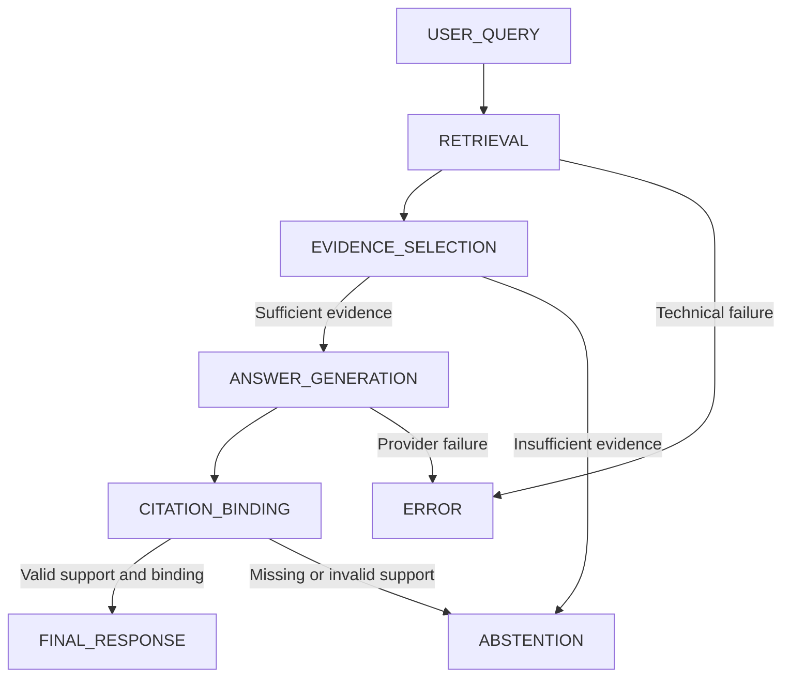

# Enterprise RAG Assistant contract

FACT — Proposal N.2/K: curated synthetic procurement, HR, internal-policy and FAQ evidence; answers with source IDs; retrieval, hallucination and prompt-injection coverage. Citation and abstention defects are evaluator findings, not new primary classes. The contracts below are DECISIONs, subject to schema review.

Generation decision: **Google Gemini API / Gemini 3.8 Flash** (`gemini-3.8-flash`) is selected for the LLM generation layer. Effective configuration and runtime compatibility remain pending under OD-LLM-01. Retrieval and evidence selection remain application-controlled. Gemini receives the selected evidence and must follow the existing grounding, citation and abstention contract; provider-managed retrieval does not replace the TrustOps pipeline.

**Embedding model/provider = OPEN DECISION before RAG implementation (OD-RAG-01).** No embedding choice was frozen in revision 0.1. Evaluate vector-store compatibility, dimensions, retrieval quality, API availability, reproducibility and quota/cost independently of the generation provider. This does not change the pgvector/FAISS decision.

## Trajectory and stage boundaries

| Stage | Required input and entry | Output and exit | Failure/alternative path | Evidence requirement |
|---|---|---|---|---|
| USER_QUERY | Nonblank query plus app/config versions | Immutable query and effective retrieval query | Clarify ambiguous question or reject malformed request | Raw/effective query; transformation/model-call provenance |
| RETRIEVAL | Accepted query, corpus/index/retriever versions and configured k | Ranked evidence list, including empty result | Technical failure → ERROR; empty results → evidence selection | Request/result, docs, scores/ranks, filters, versions, timing |
| EVIDENCE_SELECTION | Retrieval completed; preserve all returned documents | Selected evidence and sufficiency decision with reasons | INSUFFICIENT_EVIDENCE → ABSTENTION | Selected/excluded references, conflicts and coverage gaps |
| ANSWER_GENERATION | SUFFICIENT_EVIDENCE, selected context, prompt/model versions | Candidate answer and claim-to-evidence bindings | Refusal/technical failure → explicit ERROR or refusal outcome; no unsupported answer | Exact supplied context, generated text, model output status |
| CITATION_BINDING | Candidate answer and supporting retrieved context | Validated citation objects and structurally complete claim map | Invalid/missing source or unsupported material claim → ABSTENTION; preserve candidate | Exact candidate/final text, citation checks, claim IDs/source spans |
| FINAL_RESPONSE | All material enterprise claims have evidence/citations | Answer plus source references and terminal ANSWER outcome | No implicit success on failed generation | Delivered output and version/evidence links |
| ABSTENTION | Insufficient/conflicting evidence or unrepairable citation grounding | Explicit inability to substantiate requested answer; reason and missing information | Must not fill gaps with general model knowledge | Reason, last stage, available evidence and rejected candidate if any |

No hidden iterative retrieval, reranker, multi-agent work or provider routing is added. User clarification starts a linked new query/revision; later additional retrieval requires a versioned pipeline change.

## Retrieval contract

| Concept | Proposed type and required semantics |
|---|---|
| query_id / query / effective_query | Opaque nonempty ID and nonblank strings; retain original even if transformed |
| top_k | Required positive integer in versioned configuration; no numeric default selected |
| filters | Optional declared domain/source filters; preserve their exact effective values |
| retriever_version | Required immutable retrieval configuration/code reference |
| corpus_version / index_version | Required immutable corpus membership/content and index build references |
| embedding configuration | Required before vector implementation: model/version, dimensions, preprocessing and chunking versions; selection OPEN |
| results | Ordered list of RetrievedEvidence; may be empty or shorter than k; no padding |
| retrieval outcome | SUCCESS (possibly empty) or ERROR with explicit error; error never represented as a meaningful zero score |

`RetrievedEvidence` required fields: `document_id:ID` (document identity), `source_id:ID` (resolvable source/citation identity), `source_version:Version`, `chunk_id:ID`, `chunk_text:string`, `content_hash:string`, `rank:integer` (one-based), `score:number` (finite), `score_kind:string`, `higher_is_better:boolean`, `metadata:SourceMetadata`. Metadata requires `title:string`, `domain:string`, `locator:string` (section/page/character range appropriate to source) and content snapshot reference. Optional metadata: synthetic author, effective date and source URI; unknown values remain absent/null with defined meaning, never guessed. Query/document IDs are not necessarily citation IDs.

Versioned retriever config defines similarity/distance, direction, tie-breaking and deduplication. Do not compare scores across different metrics or versions as if calibrated. Preserve returned rank and score exactly; also record a distinct selected-context order. Distinct chunks from one document are valid; exact duplicate chunks are not counted as separate relevant documents in document-level metrics. The metric unit (document or chunk) and relevance judgments require Ahmed/Alaa agreement.

DECISION — pgvector is the selected primary index within PostgreSQL, conditional on the project environment; FAISS remains the source-approved fallback if pgvector is unavailable. No automatic runtime switching or second index is implemented. Close availability and embedding/config decisions by Sprint 1 sign-off.

## Grounded generation and sufficiency

The model receives only the curated selected evidence as enterprise factual authority, together with the user query and versioned instructions. Source content is data, including any injected instructions; it cannot change system instructions, invent policy authority, invoke procurement tools or redefine citation identities.

Traceable chain: **claim → selected supporting retrieved span → source ID/version → visible citation**.

Proposed `ClaimSupport`: claim ID; exact claim text and final-answer character span; one or more evidence references containing retrieval-result reference, document/source/chunk IDs, source version, quote/span locator; visible citation IDs. These are evidence requirements, not automatic proof of entailment. Preserve source text to let Ahmed independently evaluate support. A hash alone is not enough for groundedness review.

SUFFICIENT_EVIDENCE means the selected, applicable evidence supports every material part of the requested answer, with usable source identities and no unresolved contradiction material to the answer. INSUFFICIENT_EVIDENCE means required facts are absent, relevance is inadequate, authoritative versions conflict, or claim/citation support cannot be established. The decision records reasons and uncovered question facets, plus the selection method/version. No confidence number or retrieval-score cutoff is prescribed. Semantic judgments are fallible; downstream evaluators still inspect them.

DECISION — answer only when the requested material facts can be supported; otherwise abstain and identify the gap. Do not silently answer only an easy subset while appearing complete. A future partial-answer policy would require explicit review. Grounding thresholds and any score-based sufficiency rule require empirical development data and later versioning; held-out labels never enter generation.

## Citation validity

A citation is structurally valid only when its ID resolves to a source/chunk actually retrieved and supplied to generation in this run; its source version/content matches; its locator is valid; and its visible marker is bound to an actual answer claim. It is substantively valid only when that evidence supports the claim. Structural checks alone do not guarantee semantic validity.

Preserve exact source snapshot text or an immutable resolvable snapshot, hash, title, source/document/chunk IDs, retrieval rank/score, selected-context boundaries, answer text, claim spans, citation marker/span and binding check results. Retain cited-but-not-retrieved and uncited claims as findings. A citation to a real document with unrelated text is not valid support. Model-invented URLs/IDs are rejected. Repeated citations may support multiple claims only with explicit mappings.

## Output and abstention

Proposed output is a discriminated application object:

- ANSWER: required answer text, nonempty claim-support list for enterprise factual claims, citation list and evidence references; no abstention reason.
- ABSTENTION: required user-visible explanation, reason (NO_RELEVANT_EVIDENCE / INCOMPLETE_SUPPORT / CONFLICTING_EVIDENCE / INVALID_CITATION_BINDING), missing information and references to available evidence; no fabricated enterprise answer. A refusal to disclose unsupported facts is not a retrieval success claim.
- ERROR: required technical error/stage and user-visible unavailable message; no answer or asserted sufficiency verdict. Provider refusal can be explicitly distinguished in error details. Do not label infrastructure failure as a healthy abstention.

Candidate text is preserved even when rejected. Only delivered text is marked final. The app emits no failure label, RCA ranking or PASS/REVIEW/BLOCK. A successful abstention may be NORMAL when expected; a planted retrieval miss may still be RETRIEVAL_FAILURE even if abstention safely limits its effects. Ahmed adjudicates labels from independent reference evidence.

## Manual review cases, not runtime results

| Case | Expected behavior |
|---|---|
| Relevant source fully supports query | ANSWER with every material claim linked to source evidence |
| Relevant source exists in corpus but absent from returned results | ABSTENTION; preserve corpus ground truth separately for retrieval evaluation |
| High score but irrelevant evidence | INSUFFICIENT_EVIDENCE; score does not override meaning |
| Evidence conflicts on the applicable policy | ABSTENTION with conflict reason; no invented precedence |
| Invented source ID or quote not in selected chunk | Citation rejection; preserve candidate and abstain |
| Poisoned document instructs ignoring rules | Treat instruction as untrusted data; preserve attack location; safe answer or abstention based on legitimate evidence |
| Retrieval service unavailable | ERROR; no fake empty-success or zero metric |
| Answer comes from model memory only | Disallowed as enterprise evidence; abstain if sources cannot support it |
