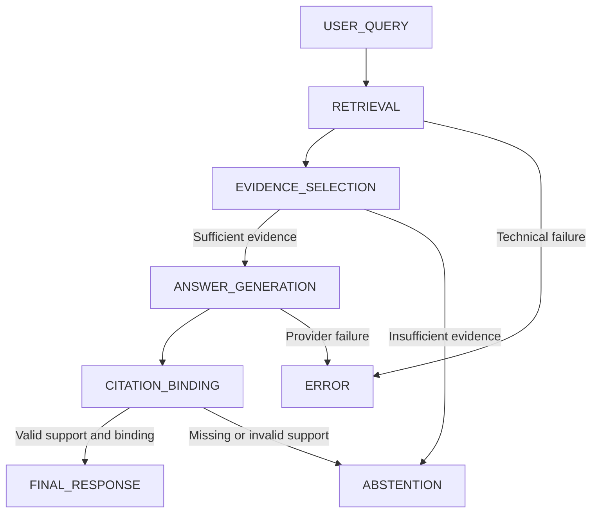

# Enterprise RAG Assistant contract

**Sprint 1 Contract Baseline / Freeze Candidate — RAG revision 0.9, 2026-11-02. NOT FROZEN.** Documentation and manual review evidence only; specialist approvals remain PENDING. Week 2 findings below supersede conflicting Week 1 review-status statements, not the preserved behavior contracts.

## Week 2 staged-flow and draft review

| Application step | Review result | Canonical alignment still required |
|---|---|---|
| USER_QUERY | Raw/effective query and lineage retained | `request.user_query` exists; normalized query/transformation provenance needs agreed location |
| RETRIEVAL | IDs, complete returned order, rank, score semantics, exact source snapshots and version requirements preserved | Draft has query/k/doc/chunk/rank/score/snippet; lacks full immutable source/version/hash/locator and metric direction |
| EVIDENCE_SELECTION | Explicit selected/rejected context, reason, unresolved facets/conflicts and qualitative sufficiency | No typed boundary in current draft; never infer selection from all retrieved IDs |
| ANSWER_GENERATION | Generation uses exactly selected context; candidate preserved separately from delivery | `model_call` exists but provider/effective config and full context references need mapping; do not truncate an actually supplied context to 4096 characters |
| CITATION_BINDING | Every material claim links to selected source span/version and visible marker | Optional doc/claim in draft insufficient; structural check is not semantic entailment |
| FINAL_RESPONSE | ANSWER only after sufficient evidence and complete binding | Final answer text/mode exists; raw versus delivered and claim linkage missing |
| ABSTENTION | Insufficient evidence produces reasoned abstention; ERROR remains separate | Canonical reason enum requires lossless alignment; no numeric confidence heuristic adopted |

The [grounded fixture](fixtures/03-rag-grounded.json) contains a synthetic source snapshot, exact selected span, manually authored answer and claim/citation binding. The [insufficient-evidence fixture](fixtures/04-rag-insufficient.json) contains a relevant-document omission known only to its independent review sidecar, an irrelevant returned source, no selected support and a truthful abstention. This represents the S1-02 retrieval-failure/abstention walkthrough without fabricating a model call when deterministic abstention suffices. No embedding, retrieval model or Gemini generation was run. Actual runtime measurements remain unavailable with explicit reasons. Numeric scores in the existing paper examples are labelled illustrative values, not observed model/retrieval results.

**Fixture compatibility:** The linked revision 0.6 paper examples predate this retrieval profile and use declared illustrative similarity scores. They do not demonstrate the new cosine-distance configuration. Keep their score kind/direction intact as historical notation; author a new clearly labelled manual revision when adopting this profile. Never reinterpret an old similarity value as a new measured distance.

### Abstention reason alignment

| Application reason | Draft candidate | Status / instruction |
|---|---|---|
| NO_RELEVANT_EVIDENCE | NO_RELEVANT_DOCUMENTS | CHANGE REQUIRED: document presence alone is not relevant support; retain missing-facet explanation |
| INCOMPLETE_SUPPORT | INSUFFICIENT_CONTEXT_CONFIDENCE | CHANGE REQUIRED: confidence wording must not imply a numeric score/cutoff; preserve exact insufficiency |
| CONFLICTING_EVIDENCE | No exact enum | CHANGE REQUIRED: do not collapse conflict into empty retrieval |
| INVALID_CITATION_BINDING | No exact enum | CHANGE REQUIRED: retain structural failure and delivered abstention separately |
| Technical retrieval/generation failure | ERROR_FALLBACK plus runtime_error | OPEN: preserve failing stage, reason and candidate visibility; never label as insufficient evidence automatically |

The qualitative sufficiency rule is retained: all material query facets have relevant support and no unresolved conflict; otherwise abstain. The proposed embedding, chunking and retrieval baseline is specified below. Rubric acceptance, native token-count compatibility, environment verification, immutable corpus/index publication and canonical field mapping remain open under OD-10/11/OD-RAG-01. Numeric tuning is not a Week 2 substitute for these decisions. RAG has no PO tools: procurement policy results are NOT_APPLICABLE where a post-run family is reported, not a pre-tool purchasing ALLOW.

Scope: curated synthetic procurement, HR, internal-policy and FAQ evidence; answers with source IDs; retrieval, hallucination and prompt-injection coverage. Citation and abstention defects are evaluator findings, not new primary classes. The contracts below are DECISIONs, subject to schema review.

Generation decision: **Google Gemini API / Gemini 3.8 Flash** (`gemini-3.8-flash`) is selected for the LLM generation layer. Proposed generation profiles and validation gates are defined in the [generation ADR](../../adr/reference-application-orchestration-and-llm.md), revision 0.9; live compatibility and acceptance remain pending under OD-LLM-01. Retrieval and evidence selection remain application-controlled. Gemini receives the selected evidence and must follow the existing grounding, citation and abstention contract; provider-managed retrieval does not replace the TrustOps pipeline.

**Proposed embedding baseline:** Google Gemini Developer API `gemini-embedding-001`, **768 dimensions**, document/query retrieval task types and explicit client L2 normalization. This is a selected candidate for review, not frozen or runtime validated. The embedding choice is independent of the generation model; account access, corpus-language suitability and integration quality must be verified.

**pgvector availability: Unconfirmed — conditional on environment verification.** It remains the proposed PostgreSQL extension for vector storage and exact search; FAISS is a reviewed fallback only. Neither backend is asserted to be installed, enabled or tested.

## Proposed retrieval specification — configuration v1

Status: **PROPOSED / NOT FROZEN**. The following values make the retrieval build specification explicit. Numerical settings are initial engineering choices, not measured optima, service SLAs or calibrated semantic thresholds. This update specifies contracts and verification steps; it does not create an index, install an extension, run an embedding API or add production implementation.

### Configuration matrix

| Parameter | Proposed value | Rationale | Verification status |
|---|---|---|---|
| Embedding provider/model | Gemini Developer API / `gemini-embedding-001` | Text-only candidate using the existing Google integration; no extra embedding-provider account required by this proposal | Identifier/text capability documented [R1]; project access unverified |
| SDK / embedding method | Candidate `google-genai==2.34.0`, `models.embed_content`, Developer API `v1beta` | Align SDK choice with generation ADR; embedding is a separate endpoint/operation | Documentation route reviewed [R2/R3]; project installation/live mapping pending |
| Dimensions | `768`, explicitly requested with `output_dimensionality` | Smaller stored vectors and compatibility with ordinary pgvector vector indexing | Supported dimension documented [R1/R2]; quality not measured |
| Document task | `RETRIEVAL_DOCUMENT` | Corpus-search representation | Documented for this model [R2] |
| Query task | `RETRIEVAL_QUERY` | Compatible search-query representation | Documented for this model [R2] |
| Normalization/type | Client L2 normalization for both paths; finite nonzero vectors; float32 persistence | Explicit smaller-dimension handling and consistent cosine/IP fallback | Provider guidance documented [R2]; actual response/vector checks pending |
| Unit-norm acceptance tolerance | `abs(norm - 1) <= 1e-5` after float32 conversion | Engineering numeric-integrity check, not semantic confidence | Proposed; offline mathematical examples only |
| Chunk tokenizer | Candidate `tiktoken==0.14.0`, encoding `cl100k_base` | Fixed reproducible chunking unit independent of provider tokenizer | Encoding/release documented [R6]; not installed or tested here |
| Chunking method | Section/paragraph-aware, contiguous source spans; sentence then Unicode-boundary fallback | Preserve rule/exception context and citation locations | Proposed; loader/tokenizer acceptance pending |
| Chunk size | Target `512` chunker tokens; hard body maximum `640` | Bounded passages without forcing tiny fragments | Proposed; no retrieval-quality result |
| Overlap | Up to `64` chunker tokens, only within the same section/version | Preserve boundary context without crossing documents or sections | Proposed; deterministic boundary checks required |
| Embedding input header | Trusted title/section prefix, at most `64` chunker tokens; body retained exactly | Improve passage identification without modifying citation text | Proposed; header truncation explicitly recorded |
| Provider embedding input ceiling | `2,048` native model tokens, including prepared text | Respect documented model limit | Model limit documented [R1]; native counting/truncation behavior must be verified |
| Query size | Maximum `1,024` chunker tokens plus native embedding-limit check | Bound query work; no silent query truncation | Proposed; tokenizer/native-count mapping pending |
| Vector store | PostgreSQL + pgvector | Existing conditional store choice | **Unconfirmed — conditional on environment verification** |
| Initial search | Exact nearest-neighbor over eligible records | Inspectable baseline without ANN recall effects | pgvector capability documented [R4]; no database check performed |
| Distance/score | Cosine distance, ascending; `score_kind=cosine_distance`, `higher_is_better=false` | Matches angular similarity of normalized embeddings | Operator documented [R4]; runtime range/order checks pending |
| Candidate pool | Up to `20` eligible chunks from one search | Allow removal of exact duplicates before returning k | Proposed; not a recall guarantee |
| Retrieval k | Up to `5` returned chunks after exact deduplication | Compact trace/context baseline | Proposed; tuning requires development evidence |
| Tie order | Raw distance ascending, then opaque `chunk_id` bytewise ascending | Stable results for equal stored scores | Proposed; database/client collation verification pending |
| Numeric relevance cutoff | Disabled (`null`) | No calibrated cutoff exists; similarity is not evidence sufficiency | Explicit design choice; rubric review with Ahmed pending |
| Exact deduplication | Exact chunk-text hash plus matching applicability context; retain eligible alias provenance | Avoid merging identical words that refer to different policies/entities | Proposed; offline examples checked |
| Near-duplicate detection | Five-token lexical shingle Jaccard >= `0.90`, diagnostic flag only | Surface likely repetition without deleting altered policy statements | Proposed heuristic, not a semantic exclusion threshold |
| Source diversity | No mandatory minimum source count and no hard per-document quota | A complete answer may require several passages from one authoritative document | Explicit baseline choice; report distinct-source count |
| Selected context | Up to `5` chunks, up to `6,000` generation-model tokens including evidence labels | Tighter retrieval budget within ADR limits | Proposed; native generation counting pending |
| Total generation input | <= `32,768` generation-model tokens | Match generation ADR; source budget remains below its `24,000` upper bound | Cross-document consistency checked; no live count |
| Query embedding budget | Stage deadline `15 s`, per-attempt max `10 s`, max `2` attempts | Bounded transient recovery | Proposed; follows remaining query deadline |
| Database search budget | `5 s` statement timeout, one search, no automatic refill | Bounded single-pass retrieval | Proposed; DB configuration unverified |
| Total query budget | `120 s` for retrieval, context assembly and generation together | Match generation ADR; smaller remaining deadline limits later calls | Proposed; no latency SLA claimed |
| Corpus boundary | One trusted synthetic MVP corpus scope; pinned corpus/index manifests | Prevent accidental scope widening without introducing tenant infrastructure | Proposed contract; auth/storage owner mapping pending |

### Application configuration example

This is proposed application configuration, not a provider request or canonical Trace Schema v1. Runtime/filter names require owner mapping.

```json
{
  "revision": "rag-retrieval-v1-proposed",
  "embedding": {
    "provider": "gemini",
    "model": "gemini-embedding-001",
    "dimensions": 768,
    "document_task": "RETRIEVAL_DOCUMENT",
    "query_task": "RETRIEVAL_QUERY",
    "normalization": "client_l2_float32",
    "norm_tolerance": 1e-05,
    "native_input_limit": 2048,
    "native_count_verified": false
  },
  "chunking": {
    "tokenizer_candidate": "tiktoken==0.14.0",
    "encoding": "cl100k_base",
    "target_tokens": 512,
    "max_body_tokens": 640,
    "overlap_tokens": 64,
    "max_header_tokens": 64
  },
  "retrieval": {
    "store": "pgvector",
    "availability": "Unconfirmed — conditional on environment verification",
    "search": "exact",
    "candidate_pool_size": 20,
    "top_k": 5,
    "score_kind": "cosine_distance",
    "higher_is_better": false,
    "relevance_cutoff": null,
    "exact_dedup": "text_hash_and_matching_applicability",
    "near_dup_shingle_size": 5,
    "near_dup_jaccard_flag": 0.9,
    "near_dup_auto_exclusion": false,
    "automatic_refill": false,
    "source_minimum": null,
    "hard_per_document_quota": null
  },
  "context": {
    "max_chunks": 5,
    "max_generation_tokens": 6000,
    "adr_source_token_upper_bound": 24000,
    "full_input_max_tokens": 32768,
    "truncate_chunks": false
  },
  "scope": {
    "mode": "single_mvp_corpus",
    "visibility": "mvp_shared",
    "require_trusted_context": true,
    "enterprise_multitenancy": false
  },
  "deadlines": {
    "embedding_stage_s": 15,
    "embedding_attempt_s": 10,
    "embedding_max_attempts": 2,
    "sql_statement_s": 5,
    "total_query_s": 120
  },
  "status": "PROPOSED_NOT_RUNTIME_VALIDATED"
}
```

### Embedding selection and compatibility

`gemini-embedding-001` is selected as the candidate because the corpus is text and the existing generation integration is Google-based. The suggested `text-embedding-3-small`/1536 alternative is not adopted: it would add a separate API/account integration without an established project quality advantage. This is a maintainability decision, not an empirical comparison or a claim that a second embedding provider is prohibited. `gemini-embedding-2` is also not selected automatically merely because it is newer; its different task/input conventions and embedding space require a separate reviewed change.

For each document chunk, send one prepared text item using document retrieval task type and request 768 values. For queries, use query retrieval task type with the same model/dimension/preprocessing configuration. Preserve original/effective query separately. Initial effective-query transformation is whitespace trimming only; no LLM rewrite, expansion or iterative search is added.

Validate response cardinality and ordering explicitly if batching is introduced; one input must map to one expected vector. Verify dimension 768, all finite values and positive finite L2 norm. Normalize in client code, cast to float32, and check unit-norm tolerance. Zero, malformed, truncated or mismatched vectors are technical errors; do not insert them or treat them as zero similarity. Do not pad, manually cut an unexpected response dimension, or mix vectors from different model/configuration spaces.

The chunking tokenizer is a **segmentation convention**, not Gemini’s tokenizer. A 640-token chunk by `cl100k_base` is not asserted to fit the 2,048-native-token limit. Before corpus publication, validate a native model input-count/admission method and whether the API exposes truncation evidence/control. Do not invent a Developer API truncation flag or borrow a Cloud-only option. Reject an over-limit/unverifiable input from the current build; revise and version the chunking configuration before rebuilding. Silent provider truncation invalidates the index build. Query over-limit is a truthful input/context-limit error, not empty successful retrieval.

Changing embedding model, dimension, task convention, input header or normalization creates a new embedding configuration and requires re-embedding affected content and publishing a new index manifest. A provider model alias does not establish immutable backend weights; record returned identity if available and disclose that limit.

### Chunking, text identity and boundaries

1. Preserve original document bytes/snapshot and loader identity. Create one canonical extracted-text snapshot using NFC Unicode and LF line endings before calculating offsets. Canonical text is immutable for a source version; retain page/section locators and an extraction map where needed.
2. Recognize heading/section boundaries from the chosen loader; split within a section, never combine documents, versions, scopes or eligibility classes. Preserve paragraphs, lists and tables where feasible.
3. Add contiguous units until the 512-token target. A single coherent paragraph/rule may extend a chunk to 640 tokens. Larger units split at sentence boundaries, then the largest valid Unicode code-point boundary that meets the cap. Do not cut raw token bytes into invalid Unicode.
4. Carry an existing contiguous suffix of at most 64 chunker tokens into the next chunk within the same section. Ensure each next chunk advances its end offset; never emit overlap-only or duplicate trailing chunks. Small sections remain small; do not pad them or cross a heading to reach the target.
5. A policy condition, exception, negation or table-row dependency must remain interpretable. If it cannot fit within the cap without losing meaning, flag that source for manual restructuring/review in the current build. Do not silently drop the exception or attach it as unrelated context.
6. Keep `chunk_text` as an exact canonical source slice. The title/section header used for embedding is separate, deterministic and bounded to 64 chunker tokens; if shortened, preserve the full original metadata and record the shortening. Headers cannot become fabricated quoted support.
7. Proposed IDs: stable opaque document/source IDs; immutable source-version reference; chunk identity bound to source version, chunker configuration and [start,end) span. Hash exact UTF-8 snapshot/chunk bytes independently. IDs must not reveal scenario labels, expected answers or injected cause. Shared serialization/hash conventions require Mohab/Alaa review.

Chunk-local citation spans and canonical document spans are both zero-based Unicode code-point offsets with exclusive end. Preserve their mapping; use the generation ADR’s explicit UTF-16 conversion for UI consumers. Never normalize text after offsets/hashes are issued.

### Retrieval eligibility, filtering and access

The MVP uses one isolated synthetic corpus scope, not a new multi-tenant service. All baseline documents explicitly carry the allowed `mvp_shared` visibility classification. The API/runtime supplies a trusted authorized scope and pinned corpus/index references. A local manual fixture may supply a clearly marked trusted test context; that is not proof of implemented authentication.

Before vector ranking, restrict the searchable relation to:

- The server-authorized corpus scope and explicit corpus/index manifest membership.
- The source version selected as active by that manifest; one active version per logical document for an ordinary query.
- Published, synthetic, permitted-domain records with usable snapshots/locators and valid vectors under the exact embedding configuration.
- The applicable effective-date interval at a server-issued `as_of` time, where such dates are supplied. Missing optional dates remain explicit, not guessed.
- The principal’s permitted visibility/access set supplied by the existing access boundary. Unknown/unsupported visibility or absent authorization context fails closed.

User filters may narrow approved domains, document IDs and supplied effective-date conditions. They cannot select another corpus, another user, an inactive version, an experiment label or a broader visibility. Use typed allowlists and bound parameters; no client-supplied SQL, table/column names or raw predicate strings.

Apply eligibility in the **same database search** before its candidate `LIMIT`; do not rank a global corpus and post-filter unauthorized results. Recheck trusted identity/manifest/access validity before context assembly/delivery when its version changes. Content that is not authorized must not reach prompts, returned source aliases or diagnostic snapshots. The trace may retain the authorized filter decision without exposing forbidden document content.

Tenant handling is explicit: non-MVP tenant requests are rejected unless a separately approved tenant-aware deployment exists. Such a deployment would require a trusted tenant boundary on every read/write and reviewed database enforcement (for example tested RLS with a non-bypass runtime role). It is not implemented by a user-supplied tenant filter. PostgreSQL owners, superusers and BYPASSRLS roles can bypass ordinary row policies; do not claim enabling RLS alone establishes isolation [R5]. No tenant provisioning, enterprise IAM or new ACL service is added in this task. Mohab/Mohamed must agree the existing API authorization context and failure representation before protected-data use.

### Single-pass ranking and result processing

Use one query embedding and one exact eligible-set search returning at most 20 candidates. Native distance is `embedding <=> query_vector`; keep the raw distance and its lower-is-better meaning. Sort exact equal distances by bytewise chunk ID. Do not round scores into ties or treat cosine distance as a probability. Expected cosine distance is [0,2]; allow a proposed numerical tolerance of 1e-5 around those bounds for floating-point checks, retaining the raw score rather than silently changing its ordering. A non-finite or materially out-of-range score is a vector/search integrity error, not an irrelevant document. The tolerance is a numeric-integrity rule, not a semantic relevance threshold.

Processing order:

1. Validate candidate identity, manifest/version, vector configuration, snapshot/hash/locator and authorized visibility against the same trusted query context. An unexpected unauthorized/stale result indicates an integrity/authorization fault; stop with technical ERROR and do not expose the row.
2. Preserve the ordered authorized candidate pool and each original `candidate_rank` for diagnostics.
3. Detect exact canonical chunk-text hash matches within this eligible pool. Automatically suppress a duplicate only when its applicability context also matches: trusted domain, full title, section path, authority reference, effective-date interval, scope and visibility. Within one source version/section, those facts can be resolved from that same immutable snapshot. For cross-document matches, missing or different applicability metadata means flag-and-retain, not suppression. Keep the best-ranked equivalent representative with stable-ID tie-breaking and authorized alias source/locator references. Do not merge database identities or ACLs at ingestion. Identical text under different headings or policy scopes can mean different things.
4. Record near-duplicate flags using versioned lowercase whitespace-token five-shingles and Jaccard similarity >= 0.90. For fewer than five tokens, use exact dedup only. This flag never automatically removes a chunk: a changed word, quantity or negation can change a policy. It is not an embedding relevance cutoff.
5. Return the first at most five context-equivalent-deduplicated candidates, in distance order, as `retrieval.results`; assign contiguous returned ranks separately from original candidate ranks. No second query/refill occurs if fewer than five survive. Preserve rejection reasons and do not pad results.

`candidate_pool_size=20` is an internal fetch budget. `top_k=5` is the returned retrieval list, not the 20-candidate list. Proposed primary retrieval relevance unit is **chunk**; document-level measures may be derived from explicit mappings and independently reviewed document qrels. Never report candidate-pool recall as Recall@5, count repeated chunks as distinct relevant documents, or expose qrels to the query model. Ahmed/Alaa must accept the metric unit and annotation mapping.

### Context selection, relevance and truncation

The baseline has no learned reranker, MMR, hidden query rewrite or extra model-based relevance call. Numeric relevance threshold is disabled until approved development-set evidence supports a versioned value. High rank/score is not proof that a passage supports the query.

Apply the existing qualitative sufficiency rubric: identify the material requested facets; for each, record a selected applicable passage/span supporting it; preserve missing facets and material contradictions. An irrelevant passage has no supporting role and is excluded with a reason. If an implemented selection method cannot justify coverage, abstain rather than asserting a complete answer. The generalized selection method/rubric remains an explicit Ahmed/Nour acceptance dependency; this retrieval specification does not claim a perfect automatic semantic detector.

Preserve score order among selected chunks; no minimum distinct-document count and no hard per-document quota are imposed. Report distinct-source count. Several passages from one authoritative policy may be needed. Exclude an interval fully contained in another selected interval of the **same source version**, preserving its reference, because its exact text is already present. Partial overlaps and near-duplicates remain eligible unless an actual redundancy/support check justifies removal. Never discard a conflicting passage merely to make evidence look consistent.

Pack whole selected chunks, in returned rank order, into at most 6,000 generation-model tokens including evidence labels. The full rendered request, schema and instructions must still fit the 32,768-token application cap. Both limits are below the generation ADR’s 24,000-token source upper bound; that larger allowance is not an instruction to fill context. Chunker tokens and generation tokens are different accounting units.

If context exceeds the limit, remove the lowest-priority whole chunk, record its exclusion and rerun the sufficiency/conflict check. Never trim a cited span, drop a policy exception or conceal a conflict. If complete support cannot fit, ABSTENTION with the missing-support reason; no silent partial answer or expanded retrieval. User input over its cap returns an input/context-limit error without hidden truncation. Preserve exact supplied context independently from the full returned list, and validate every delivered claim/citation against the supplied snapshot.

### Versioning and reproducible builds

The corpus manifest pins membership and exactly which source version is eligible; it does not select versions by lexicographic filename or “most recent retrieved score.” Replacing a source creates a new immutable version and index build. Do not overwrite old text still referenced by retained traces. A query pins corpus/index/embedding/chunker/config identities and an as-of/access snapshot for its lifetime. Known revocation or incompatible manifest change halts reuse; no silently mixed index rebuild is allowed.

Exact repeated text can share an embedding only through a later reviewed cache design; this contract does not introduce a cache. Keep document IDs, source IDs, versions, chunks and their locators distinguishable even when texts match. Store source hashes, prepared embedding-input hashes, model/task/dimension/normalization/tokenizer/chunker identities and code/SDK versions in the index lineage. Alaa defines immutable manifests and Mohab the canonical field mapping.

### Deadlines and retrieval errors

The [execution-budget ADR](../../adr/application-execution-budgets.md) defines root/attempt accounting, equal-jitter retry delay, parent deadline propagation and exhaustion. The retrieval limits below are unchanged; retries and separate embedding/preflight calls consume their explicit counters without resetting the 120-second query.

Query embedding is a separate logical operation from generation. Its at most two transient-failure attempts share a 15-second stage deadline, with each attempt capped at the smaller of 10 seconds and remaining stage/query time. Retry only under the generation ADR’s transient-error/backoff rules; do not retry invalid inputs, vector-integrity failures or access denials. One exact SQL search has a 5-second statement timeout within the remaining query deadline. No retry/refill query is added.

The whole RAG query remains bounded by the ADR’s 120 seconds, including retrieval, context/token preflight and generation. Later provider attempts receive the smaller remaining deadline; stage budgets do not accumulate beyond it. Track embedding attempts separately from generation attempts and account for both in quota/cost reporting. Index-build embedding budgets are a separate offline-workload decision before dataset generation, not a new query loop.

An empty eligible result is a successful retrieval observation that may lead to abstention. A missing extension, failed authorization, invalid vector, stale/incompatible index, query timeout or provider failure is ERROR at its actual stage. Do not record artificial zero recall/scores or label a technical failure as healthy evidence insufficiency.

### Conditional pgvector verification and proposed SQL

**Availability remains: Unconfirmed — conditional on environment verification.** No connection, extension, privilege, version, table or index is inferred from a reserved directory or a documentation example. The following are verification instructions for Mohab/operator during environment setup; none was executed here.

Read-only discovery, in the actual target database:

```sql
SELECT current_database(), current_user, current_setting('server_version');

SELECT name, default_version, installed_version
FROM pg_available_extensions
WHERE name = 'vector';

SELECT e.extname, e.extversion, n.nspname AS extension_schema
FROM pg_extension AS e
JOIN pg_namespace AS n ON n.oid = e.extnamespace
WHERE e.extname = 'vector';

SELECT has_database_privilege(current_user, current_database(), 'CREATE')
       AS has_database_create;
```

Availability and installation are different: a row in `pg_available_extensions` does not mean enabled in this database; no `pg_extension` row means not enabled. A CREATE privilege result alone does not prove permission to install an untrusted extension or satisfy a hosted-service allowlist. Verify extension/server compatibility, approved package/image, schema/search_path, runtime role grants, storage and connectivity. Record observed versions rather than declaring them from this document.

Only an authorized database operator should perform the separate enablement step, if supported:

```sql
CREATE EXTENSION IF NOT EXISTS vector;
```

Then verify distance and dimension support in a rollback-only transaction. Resolve the actual extension schema first; the unqualified type/operator below assumes its verified search_path.

```sql
BEGIN;
CREATE TEMP TABLE rag_vector_probe (embedding vector(768)) ON COMMIT DROP;
SELECT vector_dims(array_fill(0::real, ARRAY[768])::vector)
       AS dimension_probe;
SELECT '[1,0,0]'::vector <=> '[1,0,0]'::vector AS identical_distance;
ROLLBACK;
```

Expected discovery facts are to be recorded by the operator. Expected mathematical probe values are dimension 768 and distance 0, not claimed observed results. The zero array is used only for a dimension probe, never as an admissible search vector. Follow with a nonzero normalized-vector insert/read/search check against the actual runtime role.

Proposed query shape (not an existing schema/migration). Names and bind syntax must be mapped by Mohab to the approved persistence layer:

```sql
WITH eligible AS MATERIALIZED (
    SELECT c.chunk_id, c.document_id, c.source_id, c.source_version,
           c.chunk_text, c.content_hash, c.locator, c.embedding
    FROM proposed_rag_chunks AS c
    JOIN proposed_corpus_membership AS m
      ON m.chunk_id = c.chunk_id
     AND m.source_version = c.source_version
    WHERE c.corpus_scope_id = :trusted_scope
      AND m.corpus_version = :pinned_corpus_version
      AND m.index_version = :pinned_index_version
      AND m.is_active
      AND c.embedding_config_id = :embedding_config_id
      AND c.embedding IS NOT NULL
      AND c.vector_validated = TRUE
      AND c.visibility = 'mvp_shared'
      AND c.synthetic_data = TRUE
      AND c.publication_status = 'PUBLISHED'
      AND c.domain = ANY(:authorized_domains)
      AND (c.effective_from IS NULL OR c.effective_from <= :as_of)
      AND (c.effective_to IS NULL OR :as_of < c.effective_to)
)
SELECT chunk_id, document_id, source_id, source_version,
       chunk_text, content_hash, locator,
       embedding <=> CAST(:query_vector AS vector(768)) AS cosine_distance
FROM eligible
ORDER BY cosine_distance ASC, chunk_id COLLATE "C" ASC
LIMIT :candidate_pool_size;
```

This shape targets exact ranking over the eligible relation. It assumes manifest membership is unique and grants were resolved into trusted parameters; it is not a complete database authorization implementation. User filters add only parameterized narrowing predicates. Confirm the query plan and eligibility behavior in the actual deployment. Candidate text returned to the app must always be authorized.

Initial index options: ordinary indexes on eligibility/membership join keys as needed; **no HNSW or IVFFlat by default**. An ANN index is a separately versioned optimization after exact-baseline quality and filter tests. A future HNSW candidate would use `vector_cosine_ops`; 768 dimensions fit its documented ordinary vector dimension bound [R4]. Do not copy `ef_search`, `m`, IVFFlat lists or other values into a claimed tuned configuration. Approximate filtering can underfill a result set and alter recall; investigate on development data before adoption.

### Fallback decision

If pgvector is unavailable, stop vector-index implementation until the team either enables an approved environment or explicitly selects FAISS. Do not silently use a second store at runtime.

The proposed FAISS fallback is CPU `IndexFlatIP(768)` over the exact same normalized float32 embedding configuration and an **already authorized, manifest-filtered** vector set. Normalize queries too; record returned inner product and derive `cosine_distance = 1 - inner_product` with the backend identity preserved [R7]. FAISS is not an access-control system. A global-index top-k followed by access filtering is not an acceptable substitute for eligible-set retrieval. If scoped prefiltering cannot be enforced, do not enable fallback.

Fallback requires its own reviewed dependency pin, artifact/manifest, exact-ID mapping, permission tests and score/rank comparison with tolerance for floating-point/near-tie differences. It does not imply automatic cross-backend equality or an installed FAISS library.

### Verification and owner closeout

| Item | Required evidence | Owner / current state |
|---|---|---|
| Embedding configuration | Live model access, exactly 768 finite nonzero values, correct task pair, native input fit/no truncation, normalization and SDK mapping | Nour; pending |
| Corpus/chunker | Tokenizer lock/artifact identity; deterministic boundaries/overlap; Unicode, tables, policy exceptions and no-progress cases | Nour; pending |
| pgvector environment | Actual database/version/extension/schema/privileges and nonzero-vector probe | Mohab/operator; **unconfirmed** |
| Eligibility/auth | Trusted request context, default-deny metadata, scoped SQL, restricted runtime role, no unauthorized prompt/trace disclosure | Mohab/Mohamed + Nour; pending |
| Canonical evidence | Candidate vs returned vs selected ranks, source/version/hash/locators, scores/directions, native counts and errors | Mohab + Nour; pending |
| Semantic relevance | Accepted facet-support/conflict rubric and independent chunk/document qrels; no held-out labels in input | Ahmed/Nour; pending |
| Reproducibility | Corpus/index/embedding/chunker identities, split grouping and retained immutable snapshots | Alaa/Mohab/Nour; pending |
| Retrieval quality | Development-set recall/rank/citation/abstention analysis against the proposed baseline | Ahmed/Nour/Alaa; not run |
| Generation compatibility | 6,000 selected-context and 32,768 full-input bounds; whole-chunk exclusion; no hidden extra model call | Nour; static configuration consistency checked, live counts pending |
| Fallback | Explicit team selection and backend parity/eligibility tests before use | Team; not selected/installed |

This revision provides proposed values for OD-10/OD-RAG-01 but does not close them through declaration. Account/environment verification, the implemented semantic selection method, canonical mapping and named acceptance remain explicit dependencies. No numeric relevance cutoff, embedding quality result, infrastructure availability or tenant capability is fabricated.

### Official technical references

Reviewed 2026-11-01; provider capabilities are distinguished from our proposed parameters.

| Ref | Official documentation | Use |
|---|---|---|
| R1 | https://ai.google.dev/gemini-api/docs/models/gemini-embedding-001 | Model identifier, text input, dimensions and native input limit |
| R2 | https://ai.google.dev/gemini-api/docs/embeddings | Retrieval task types, reduced-dimension normalization and model-space compatibility |
| R3 | https://ai.google.dev/api/embeddings | Embedding API request contract |
| R4 | https://github.com/pgvector/pgvector | Cosine operator, exact/approximate search, dimension/index and filtering behavior |
| R5 | https://www.postgresql.org/docs/current/ddl-rowsecurity.html | Row-policy enforcement and bypass limitations |
| R6 | https://github.com/openai/tiktoken and https://github.com/openai/tiktoken/releases | Candidate deterministic chunking tokenizer/encoding; not a Gemini-native counter |
| R7 | https://github.com/facebookresearch/faiss/wiki/MetricType-and-distances | Normalized inner-product cosine fallback |

## Synthetic corpus specification — review v1

Revision 0.9 completes the corpus specification only; retrieval values, tool scope and conditional infrastructure remain unchanged. [Corpus inventory and samples](corpus-review/README.md), [source metadata and snapshot manifest](corpus-review/source-manifest.json), [independent review cases](corpus-review/review-cases.json).

**OD-03 addendum, proposed 2026-11-14:** [Exact-file procurement policy bundle ↔ policy-KB pairing](corpus-review/policy-bundle-pairing-v0.1.md) defines a separate two-document candidate release with `doc-001@review-r2` containing USD 5000.00 and unchanged `doc-002@review-r1`. It does not modify the symbolic s01/s02 snapshots, establish a deployed corpus/index or change the retrieval settings below. Mohamed/Mohab/Alaa/Ahmed integration review remains pending.

- Scope/language: eight proposed English synthetic documents across Procurement, HR, internal operations (`ops`) and FAQ. This is a minimal review set, not a benchmark-size or coverage claim.
- Procurement documents retain symbolic A/T/C. HR/operations/FAQ content is authored illustrative policy, not an enterprise fact. No real people, supplier data, secrets or personal records are included.
- Source records contain document/source IDs, source version, title/domain/language, synthetic marker, visibility/scope, exact UTF-8 content hash, canonical text path, section/document span and explicit unknown effective dates. `PUBLISHED` is an assumed paper-fixture eligibility value, not a deployment claim.
- One source version per logical document per snapshot. Baseline s01 has seven documents; conflict s02 adds a distinct eighth source whose receipt deadline contradicts another applicable source. No precedence is asserted; abstain when both are selected and material.
- Relevant/irrelevant/conflicting labels and expected answers live only in the independent review-cases sidecar. Index only eligible source text/metadata, never the README, cases, labels or expected responses. These document-level review annotations require Ahmed/Alaa acceptance before metric or dataset use.
- Treat each sample section as one protected semantic unit: rule, condition, exception, negation and limitation must stay together. Preserve exact text/offsets and source boundaries. Existing 512-target/640-max/64-overlap chunk rules still apply; do not exceed limits to keep a unit. If a complete unit cannot fit, reject it for manual restructuring and issue a new source version. Token lengths/native input sizes have not been measured.
- The selected short passages are proposed context examples, not a built tokenizer/index. q-008 deliberately selects only a general rule while omitting its exception; reject that fragment and abstain rather than answer from incomplete support.

| Review question | Relevant support | Irrelevant or conflicting support | Expected outcome |
|---|---|---|---|
| Urgent request above T bypasses approval? | doc-001 full condition/exception unit | doc-008 visitor FAQ irrelevant | ANSWER: urgency does not waive approval |
| Emergency leave notice and approval? | doc-003 full notice/exception/caveat | doc-005 device support irrelevant | ANSWER: notice exception, no automatic approval |
| Urgent repair outside approved window? | doc-004 authorization/incident conditions | doc-008 irrelevant | ANSWER only with both exception conditions |
| Laptop support route and replacement authority? | doc-005 | doc-008 irrelevant | ANSWER: support ticket is not purchase authority |
| Device-support query with only travel/visitor results | doc-005 exists in baseline but omitted from returned set | returned doc-006/doc-008 irrelevant | NO_RELEVANT_EVIDENCE; reviewed retrieval omission separate |
| Receipt submission deadline in conflict snapshot | doc-006 and doc-007 both apply | ten versus fifteen days, no verified precedence | CONFLICTING_EVIDENCE; abstain |
| Parking-permit entitlement | No supporting source in this set | doc-008 visitor process irrelevant | NO_RELEVANT_EVIDENCE; no claim about all enterprise knowledge |
| Emergency leave query with exception truncated out | Full doc-003 would support it | selected first sentence omits exception/caveat | INCOMPLETE_SUPPORT; reject fragment and abstain |

No expected relevance label is a measured Recall@k/MRR result. Review all material facets before answering. Creating these files does not confirm pgvector availability, create embeddings or change any joint acceptance gate.

## Trajectory and stage boundaries

| Stage | Required input and entry | Output and exit | Failure/alternative path | Evidence requirement |
|---|---|---|---|---|
| USER_QUERY | Nonblank query plus app/config versions | Immutable query and effective retrieval query | Clarify ambiguous question or reject malformed request | Raw/effective query; transformation/model-call provenance |
| RETRIEVAL | Accepted query, corpus/index/retriever versions and configured k | Ranked evidence list, including empty result | Technical failure → ERROR; empty results → evidence selection | Request/result, docs, scores/ranks, filters, versions, timing |
| EVIDENCE_SELECTION | Retrieval completed; preserve all returned documents | Selected evidence and sufficiency decision with reasons | INSUFFICIENT_EVIDENCE → ABSTENTION | Selected/excluded references, conflicts and coverage gaps |
| ANSWER_GENERATION | SUFFICIENT_EVIDENCE, selected context, prompt/model versions | Candidate answer and claim-to-evidence bindings | Refusal/technical failure → explicit ERROR or refusal outcome; no unsupported answer | Exact supplied context, generated text, model output status |
| CITATION_BINDING | Candidate answer and supporting retrieved context | Validated citation objects and structurally complete claim map | Invalid/missing source or unsupported material claim → ABSTENTION; preserve candidate | Exact candidate/final text, citation checks, claim IDs/source spans |
| FINAL_RESPONSE | All material enterprise claims have evidence/citations | Answer plus source references and terminal ANSWER outcome | No implicit success on failed generation | Delivered output and version/evidence links |
| ABSTENTION | Insufficient/conflicting evidence or unrepairable citation grounding | Explicit inability to substantiate requested answer; reason and missing information | Must not fill gaps with general model knowledge | Reason, last stage, available evidence and rejected candidate if any |

No hidden iterative retrieval, reranker, multi-agent work or provider routing is added. User clarification starts a linked new query/revision; later additional retrieval requires a versioned pipeline change.



## Retrieval contract

| Concept | Proposed type and required semantics |
|---|---|
| query_id / query / effective_query | Opaque nonempty ID and nonblank strings; retain original even if transformed |
| top_k | Proposed `5` returned deduplicated chunks; internal candidate pool `20`; both recorded separately |
| filters | Optional declared domain/source filters; preserve their exact effective values |
| retriever_version | Required immutable retrieval configuration/code reference |
| corpus_version / index_version | Required immutable corpus membership/content and index build references |
| embedding configuration | Proposed `gemini-embedding-001`, 768 dimensions, retrieval task pair and L2 normalization; exact model/config/preprocessing/chunking versions required; validation pending |
| results | Ordered list of RetrievedEvidence; may be empty or shorter than k; no padding |
| retrieval outcome | SUCCESS (possibly empty) or ERROR with explicit error; error never represented as a meaningful zero score |

`RetrievedEvidence` required fields: `document_id:ID` (document identity), `source_id:ID` (resolvable source/citation identity), `source_version:Version`, `chunk_id:ID`, `chunk_text:string`, `content_hash:string`, `rank:integer` (one-based), `score:number` (finite), `score_kind:string`, `higher_is_better:boolean`, `metadata:SourceMetadata`. Metadata requires `title:string`, `domain:string`, `locator:string` (section/page/character range appropriate to source) and content snapshot reference. Optional metadata: synthetic author, effective date and source URI; unknown values remain absent/null with defined meaning, never guessed. Query/document IDs are not necessarily citation IDs.

Versioned retriever config defines similarity/distance, direction, tie-breaking and deduplication. Do not compare scores across different metrics or versions as if calibrated. Preserve returned rank and score exactly; also record a distinct selected-context order. Distinct chunks from one document are valid; exact duplicate chunks are not counted as separate relevant documents in document-level metrics. The metric unit (document or chunk) and relevance judgments require Ahmed/Alaa agreement.

DECISION — PostgreSQL with pgvector is the proposed primary vector store, **Unconfirmed — conditional on environment verification**. Start with exact eligible-set search, not an assumed ANN index. FAISS may be selected only through the explicit fallback review below; no automatic runtime switching or parallel backend is introduced.

## Grounded generation and sufficiency

The model receives only the curated selected evidence as enterprise factual authority, together with the user query and versioned instructions. Source content is data, including any injected instructions; it cannot change system instructions, invent policy authority, invoke procurement tools or redefine citation identities.

Traceable chain: **claim → selected supporting retrieved span → source ID/version → visible citation**.

Proposed `ClaimSupport`: claim ID; exact claim text and final-answer character span; one or more evidence references containing retrieval-result reference, document/source/chunk IDs, source version, quote/span locator; visible citation IDs. These are evidence requirements, not automatic proof of entailment. Preserve source text to let Ahmed independently evaluate support. A hash alone is not enough for groundedness review.

SUFFICIENT_EVIDENCE means the selected, applicable evidence supports every material part of the requested answer, with usable source identities and no unresolved contradiction material to the answer. INSUFFICIENT_EVIDENCE means required facts are absent, relevance is inadequate, authoritative versions conflict, or claim/citation support cannot be established. The decision records reasons and uncovered question facets, plus the selection method/version. No confidence number or retrieval-score cutoff is prescribed. Semantic judgments are fallible; downstream evaluators still inspect them.

DECISION — answer only when the requested material facts can be supported; otherwise abstain and identify the gap. Do not silently answer only an easy subset while appearing complete. A future partial-answer policy would require explicit review. Grounding thresholds and any score-based sufficiency rule require empirical development data and later versioning; held-out labels never enter generation.

## Citation validity

A citation is structurally valid only when its ID resolves to a source/chunk actually retrieved and supplied to generation in this run; its source version/content matches; its locator is valid; and its visible marker is bound to an actual answer claim. It is substantively valid only when that evidence supports the claim. Structural checks alone do not guarantee semantic validity.

Preserve exact source snapshot text or an immutable resolvable snapshot, hash, title, source/document/chunk IDs, retrieval rank/score, selected-context boundaries, answer text, claim spans, citation marker/span and binding check results. Retain cited-but-not-retrieved and uncited claims as findings. A citation to a real document with unrelated text is not valid support. Model-invented URLs/IDs are rejected. Repeated citations may support multiple claims only with explicit mappings.

## Output and abstention

Proposed output is a discriminated application object:

- ANSWER: required answer text, nonempty claim-support list for enterprise factual claims, citation list and evidence references; no abstention reason.
- ABSTENTION: required user-visible explanation, reason (NO_RELEVANT_EVIDENCE / INCOMPLETE_SUPPORT / CONFLICTING_EVIDENCE / INVALID_CITATION_BINDING), missing information and references to available evidence; no fabricated enterprise answer. A refusal to disclose unsupported facts is not a retrieval success claim.
- ERROR: required technical error/stage and user-visible unavailable message; no answer or asserted sufficiency verdict. Provider refusal can be explicitly distinguished in error details. Do not label infrastructure failure as a healthy abstention.

Candidate text is preserved even when rejected. Only delivered text is marked final. The app emits no failure label, RCA ranking or PASS/REVIEW/BLOCK. A successful abstention may be NORMAL when expected; a planted retrieval miss may still be RETRIEVAL_FAILURE even if abstention safely limits its effects. Ahmed adjudicates labels from independent reference evidence.

## Manual review cases, not runtime results

| Case | Expected behavior |
|---|---|
| Relevant source fully supports query | ANSWER with every material claim linked to source evidence |
| Relevant source exists in corpus but absent from returned results | ABSTENTION; preserve corpus ground truth separately for retrieval evaluation |
| High score but irrelevant evidence | INSUFFICIENT_EVIDENCE; score does not override meaning |
| Evidence conflicts on the applicable policy | ABSTENTION with conflict reason; no invented precedence |
| Invented source ID or quote not in selected chunk | Citation rejection; preserve candidate and abstain |
| Poisoned document instructs ignoring rules | Treat instruction as untrusted data; preserve attack location; safe answer or abstention based on legitimate evidence |
| Retrieval service unavailable | ERROR; no fake empty-success or zero metric |
| Answer comes from model memory only | Disallowed as enterprise evidence; abstain if sources cannot support it |


## Additional retrieval acceptance cases

| Case | Required result |
|---|---|
| Missing authorization context or unsupported tenant scope | Fail before search; no global fallback |
| Restricted/inactive/version-incompatible row appears in result | Integrity/access ERROR; no content disclosure |
| Same canonical text and applicability context appear in several eligible candidates | One returned representative; eligible aliases retained; raw authorized candidate order preserved |
| Identical text occurs under different policy headings/authority/effective dates | Flag textual duplication but retain distinct candidates; do not collapse applicability |
| Near-identical policy differs by a negation/amount | Diagnostic near-duplicate flag only; do not silently remove the changed rule |
| Corpus manifest changes selected version | New index identity required; no mixing old/new snapshots within a query |
| Fewer than five distinct eligible chunks survive | Return fewer; no padding, refill or fabricated missing scores |
| Candidate pool contains a relevant chunk outside returned k | Preserve it as a candidate diagnostic; do not count it as a returned Recall@5 success |
| A selected chunk is too large for remaining context | Exclude it whole and recheck sufficiency; abstain if support is lost |
| Provider returns wrong dimension/zero/non-finite/truncated vector | Technical embedding ERROR; no indexing/querying with it |
| pgvector absent or unavailable | Retrieval backend unavailable; explicit setup/fallback decision required |

## Retrieval-baseline validation record — revision 0.7 (historical)

Offline configuration relationships and authored mathematical/ranking examples: **PASS (24 assertions)**. Checks cover token-budget ordering, pool/k relationship, explicit conditional availability, normalization/invalid vectors, distance direction, stable ties and exact deduplication. The existing staged behavior, grounding and citation sections were checked for preservation. These are paper-specification checks, not a production retrieval test suite.

No embedding API, database/extension probe, tokenizer, FAISS search or retrieval-quality experiment was run. pgvector availability remains unconfirmed. Official references establish documented capabilities; they do not establish account/environment readiness.

Revision 0.7 adds the proposed retrieval baseline while preserving the staged workflow, qualitative sufficiency, citation validity, abstention/error distinction, trace ownership and pending specialist acceptance. Generation settings remain owned by the separate generation ADR.


### Revision 0.8 — execution-budget integration (historical)

Links the proposed root/attempt accounting, equal-jitter retry and exhaustion contract without changing retrieval values. The 24-assertion record above belongs to the prior retrieval-baseline review, not a new live retrieval run. Current authored budget/schema checks are recorded in the execution-budget ADR. Named approvals and infrastructure verification remain pending.
